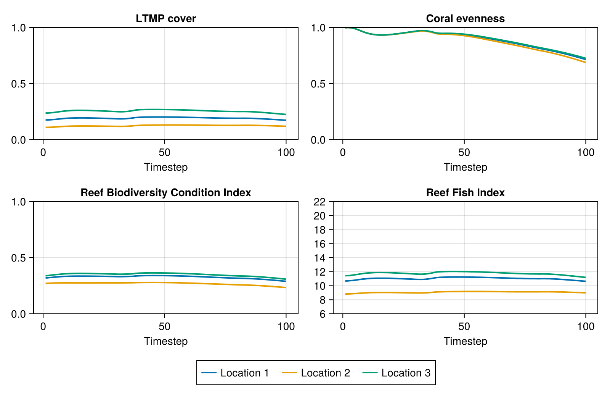
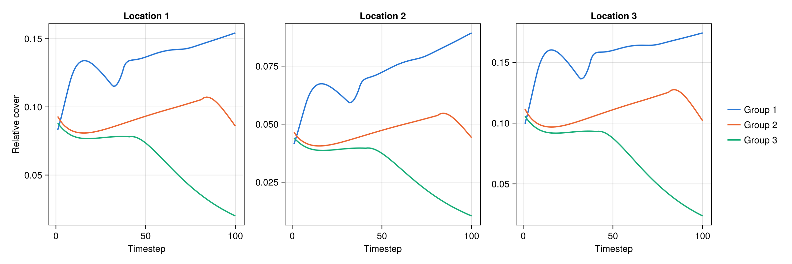
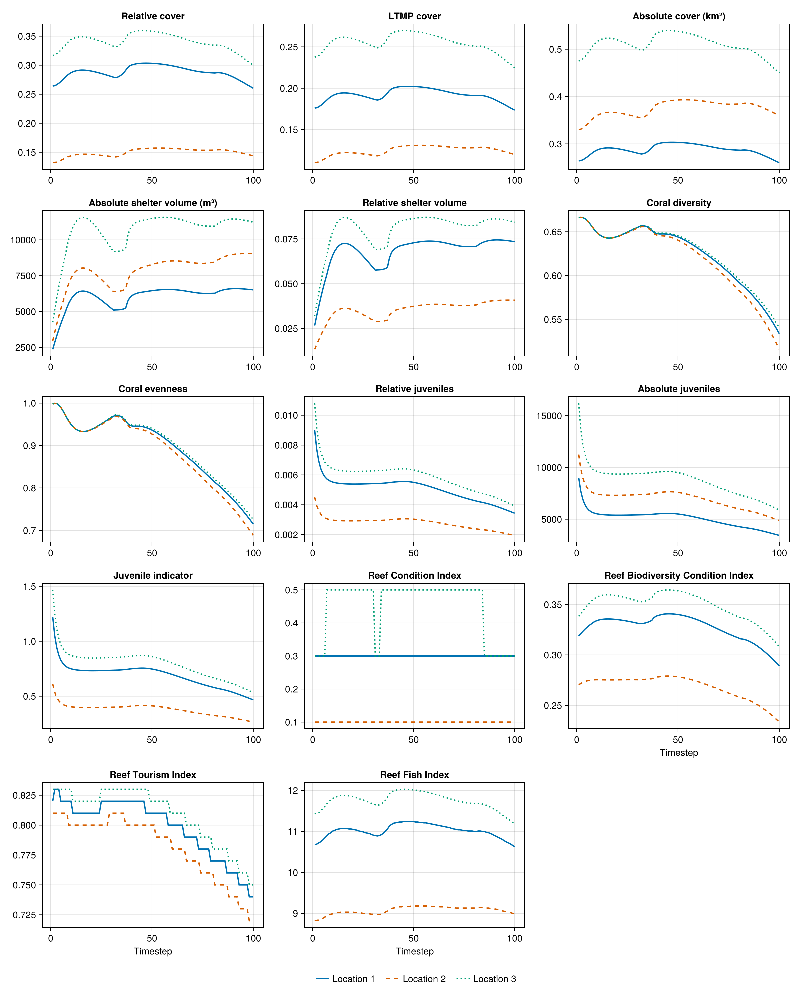

# CoralBlox.jl

[CoralBlox.jl](https://github.com/open-AIMS/CoralBlox.jl) is a coral growth and mortality
model, simulating coral functional groups competing for limited space over time. It is
intended to be used in conjunction with [ADRIA](https://github.com/open-AIMS/ADRIA.jl).
Models differ in the units they report, the order of their array dimensions and the level of
detail they resolve, so model output rarely matches the input ADRIAIndicators expects (see
[Usage](@ref "Usage")). This example shows how to adapt CoralBlox output to those
conventions and which metrics can be calculated from it, and can be used as a starting point
for incorporating ADRIAIndicators into your own workflow.

The example is not meant to describe a real reef: CoralBlox is run with synthetic,
hand-picked parameter values, so the outputs should not be read as ecological projections
and are illustrative only.

Note: To run the following code, CoralBlox.jl should be added to the environment.

Keep in mind that CoralBlox on its own has no disturbances: cyclones, heat stress and
crown-of-thorns starfish are not part of the model, so the simulated trajectories reflect
only growth, mortality and competition for space.

```julia
using CoralBlox: FunctionalGroup
using CoralBlox: linear_extension_scale_factors, max_projected_cover
using CoralBlox: timestep!, coral_cover

import ADRIAIndicators as AI
```

## 1. CoralBlox simulation

This follows the CoralBlox Quick Start, wrapped in a function so that it can be run for
each location. CoralBlox output is absolute coral cover in m² with dimensions
`[timesteps ⋅ groups ⋅ sizes]`.

```julia
n_timesteps = 100
n_functional_groups = 3
n_size_classes = 4

# Each row contains the size class bounds of a functional group (m, as diameters)
size_class_bounds = [
    0 0.05 0.8 1.4 1.5
    0 0.05 0.5 0.9 1.0
    0 0.05 0.5 0.9 1.0
]

# Mock initial coral cover, as a proportion of habitable area
initial_relative_cover = [
    0.003 0.04 0.03 0.01
    0.003 0.05 0.03 0.01
    0.003 0.05 0.03 0.005
]

linear_extensions = [
    0.004 0.025 0.1 0.0
    0.003 0.007 0.005 0.0
    0.002 0.004 0.01 0.0
]

survival_rate = [
    0.6 0.9 0.95 0.95
    0.6 0.92 0.95 0.95
    0.6 0.92 0.96 0.96
]

recruitment_weight_per_group = [0.003, 0.008, 0.02]
"""

Run CoralBlox for a single location. Returns absolute coral cover in m² with dimensions
[timesteps ⋅ groups ⋅ sizes].

"""
function run_coralblox(habitable_area::Float64, initial_cover_scale::Float64)
    C_cover = zeros(n_timesteps, n_functional_groups, n_size_classes)
    C_cover[1, :, :] = initial_relative_cover .* initial_cover_scale .* habitable_area

    functional_groups = FunctionalGroup.(
        eachrow(size_class_bounds[:, 1:(end - 1)]),
        eachrow(size_class_bounds[:, 2:end]),
        eachrow(C_cover[1, :, :])
    )

    habitable_max_projected_cover = max_projected_cover(
        linear_extensions, size_class_bounds, habitable_area
    )

    # Spatial competition only applies once cover exceeds this threshold
    scale_threshold = 0.7 * habitable_area

    for tstep in 2:n_timesteps
        scale_factor = if sum(C_cover[tstep - 1, :, :]) < scale_threshold
            1
        else
            linear_extension_scale_factors(
                C_cover[tstep - 1, :, :],
                habitable_area,
                linear_extensions,
                size_class_bounds,
                habitable_max_projected_cover
            )
        end

        growth_rate = linear_extensions .* scale_factor

        # Mock recruits, for example purposes only. Recruits (m² of cover) for each
        # functional group are proportional to the cover of its adults (all but the first
        # size class), scaled by a group-specific recruitment weight and by an availability
        # factor that decreases from 1 (no cover) to ~0.44 (full cover) as habitable area
        # fills up. In reality, recruits would come from a fecundity model.
        available_proportion =
            (habitable_area - sum(C_cover[tstep - 1, :, :])) / habitable_area
        adults_cover = dropdims(sum(C_cover[tstep - 1, :, 2:end], dims=2), dims=2)
        recruitment_availability_factor = log(2.5, 1.5 + available_proportion)
        recruits =
            adults_cover .* recruitment_weight_per_group .* recruitment_availability_factor

        timestep!(functional_groups, recruits, growth_rate, survival_rate)
        coral_cover(functional_groups, @view(C_cover[tstep, :, :]))
    end

    return C_cover
end

# Three locations differing in area and initial cover
habitable_area_m2 = [1.0e6, 2.5e6, 1.5e6]   # [locations], m²
reef_area_m2 = [1.5e6, 3.0e6, 2.0e6]        # [locations], m², includes non-habitable area
initial_cover_scale = [1.0, 0.5, 1.2]

# Absolute coral cover in m² [timesteps ⋅ groups ⋅ sizes ⋅ locations]
C_cover = stack(run_coralblox.(habitable_area_m2, initial_cover_scale))
```

## 2. Adapting the output to ADRIAIndicators

ADRIAIndicators expects *relative* cover (a proportion of habitable area) with dimensions
`[timesteps ⋅ groups ⋅ sizes ⋅ locations]`. CoralBlox orders its dimensions as
`[timesteps ⋅ groups ⋅ sizes]` for each location, so stacking the locations along the last
dimension already matches. The only conversion needed is m² to a proportion of habitable
area.

```julia
rel_cover = C_cover ./ reshape(habitable_area_m2, 1, 1, 1, :)

habitable_area_km2 = habitable_area_m2 ./ 1e6
```

## 3. Cover

```julia
# Relative cover, proportion of habitable area [timesteps ⋅ locations]
total_relative_cover = AI.relative_cover(rel_cover)

# Relative cover per functional group, summed across locations [timesteps ⋅ groups]
relative_taxa_cover = AI.relative_taxa_cover(rel_cover, habitable_area_m2)

# Relative cover per functional group and location [timesteps ⋅ groups ⋅ locations]
relative_loc_taxa_cover = AI.relative_loc_taxa_cover(rel_cover)

# LTMP cover is relative to the whole reef area instead of the habitable area
ltmp_cover = AI.ltmp_cover(rel_cover, habitable_area_m2, reef_area_m2)
ltmp_taxa_cover = AI.ltmp_taxa_cover(rel_cover, habitable_area_m2, reef_area_m2)
ltmp_loc_taxa_cover = AI.ltmp_loc_taxa_cover(rel_cover, habitable_area_m2, reef_area_m2)

# Absolute cover [timesteps ⋅ locations], km². Note that habitat area is given in km²
# here, whereas most other functions take areas in m².
absolute_cover_km2 = AI.absolute_coral_area(rel_cover, habitable_area_km2)

# Sanity check against CoralBlox's own absolute cover (m²)
@assert absolute_cover_km2 .* 1e6 ≈ dropdims(sum(C_cover; dims=(2, 3)); dims=(2, 3))
```

Relative and LTMP cover can be converted into each other, given the dimension holding the
locations. Metrics can also be aggregated across locations with `scenario_metric`.

```julia
# Convert between relative and LTMP cover, with the location in dimension 2
@assert AI.relative_cover_to_ltmp_cover(
    total_relative_cover, habitable_area_m2, reef_area_m2, 2
) ≈ ltmp_cover
@assert AI.ltmp_cover_to_relative_cover(
    ltmp_cover, habitable_area_m2, reef_area_m2, 2
) ≈ total_relative_cover

# Aggregate across locations [timesteps]
all_locations_relative_cover = AI.scenario_metric(
    total_relative_cover, habitable_area_m2, 2
)
all_locations_absolute_cover_km2 = AI.scenario_metric(
    absolute_cover_km2, habitable_area_km2, 2; is_relative=false, return_relative=false
)
```

## 4. Shelter volume

Shelter volume needs a mean colony diameter for each group and size class, and the
parameters of a log-log model relating colony size to shelter volume.

```julia
# Mean colony diameter in cm [groups ⋅ sizes]: size class midpoints, converted from m
colony_mean_diam_cm =
    100 .* (size_class_bounds[:, 1:(end - 1)] .+ size_class_bounds[:, 2:end]) ./ 2

# Parameters of the log-log planar area model [groups ⋅ sizes ⋅ (intercept, coefficient)].
# These are illustrative values shared by all groups. In practice, use parameters
# appropriate for the morphology of each functional group.
planar_area_params = zeros(Float64, n_functional_groups, n_size_classes, 2)
planar_area_params[:, :, 1] .= -8.31  # intercept
planar_area_params[:, :, 2] .= 2.47   # coefficient

# Reference colony defining the maximum shelter volume: (diameter cm, intercept, coefficient).
# Here, the largest colony in this model.
reference = (maximum(colony_mean_diam_cm), -8.31, 2.47)

# Absolute shelter volume in m³ [timesteps ⋅ groups ⋅ sizes ⋅ locations]
asv = AI.absolute_shelter_volume(
    rel_cover, colony_mean_diam_cm, planar_area_params, habitable_area_m2
)

# Relative shelter volume, dimensionless [timesteps ⋅ groups ⋅ sizes ⋅ locations]
rsv = AI.relative_shelter_volume(
    rel_cover, colony_mean_diam_cm, planar_area_params, habitable_area_m2, reference
)

# Aggregate over groups and sizes -> [timesteps ⋅ locations]
total_asv_m3 = dropdims(sum(asv; dims=(2, 3)); dims=(2, 3))
total_rsv = dropdims(sum(rsv; dims=(2, 3)); dims=(2, 3))
```

## 5. Diversity

Both diversity metrics take the relative cover per group and location
`[timesteps ⋅ groups ⋅ locations]` and return `[timesteps ⋅ locations]`.

```julia
coral_diversity = AI.coral_diversity(relative_loc_taxa_cover)
coral_evenness = AI.coral_evenness(relative_loc_taxa_cover)
```

## 6. Juveniles

Juveniles are defined by which group and size class combinations count as juvenile. Here
that is the first size class of every group.

```julia
# Which group and size class combinations are juvenile [groups ⋅ sizes]
is_juvenile = repeat([true, false, false, false]', n_functional_groups, 1)

# Juvenile cover relative to habitable area [timesteps ⋅ locations]
relative_juveniles = AI.relative_juveniles(rel_cover, is_juvenile)

# ... per functional group, across locations [timesteps ⋅ groups]
relative_taxa_juveniles = AI.relative_taxa_juveniles(
    rel_cover, is_juvenile, habitable_area_m2
)

# ... per functional group and location [timesteps ⋅ groups ⋅ locations]
relative_loc_taxa_juveniles = AI.relative_loc_taxa_juveniles(rel_cover, is_juvenile)

# Absolute juvenile cover, in the same shapes as above
absolute_juveniles = AI.absolute_juveniles(rel_cover, is_juvenile, habitable_area_m2)
absolute_taxa_juveniles = AI.absolute_taxa_juveniles(
    rel_cover, is_juvenile, habitable_area_m2
)
absolute_loc_taxa_juveniles = AI.absolute_loc_taxa_juveniles(
    rel_cover, is_juvenile, habitable_area_m2
)

# Juvenile indicator [timesteps ⋅ locations]. Note that mean colony diameters are expected
# in m here, whereas the shelter volume functions above take cm.
max_juvenile_density = 15.0  # individuals/m²
juvenile_indicator = AI.juvenile_indicator(
    rel_cover,
    is_juvenile,
    habitable_area_m2,
    colony_mean_diam_cm ./ 100,
    max_juvenile_density
)
```

## 7. Composite indices

CoralBlox does not model rubble, so only the indices that do not need it are used here.
All of them return `[timesteps ⋅ locations]`.

```julia
reef_condition_index = AI.reef_condition_index(ltmp_cover, total_rsv, juvenile_indicator)

reef_biodiversity_condition_index = AI.reef_biodiversity_condition_index(
    total_relative_cover, coral_diversity, total_rsv
)

reef_tourism_index = AI.reef_tourism_index_no_rubble(
    ltmp_cover, coral_evenness, total_rsv, relative_juveniles
)

reef_fish_index = AI.reef_fish_index(total_relative_cover)
```

## 8. Results

The indicators over time, with a line per location. Remember that CoralBlox alone has no
disturbances, so these trajectories show no cyclone, heat stress or crown-of-thorns
starfish outbreak events:



Values at the final timestep:

| Metric | Location 1 | Location 2 | Location 3 |
|---|---|---|---|
| Relative cover | 0.26 | 0.144 | 0.3 |
| LTMP cover | 0.173 | 0.12 | 0.225 |
| Absolute cover (km²) | 0.26 | 0.36 | 0.45 |
| Absolute shelter volume (m³) | 6511.333 | 9037.487 | 11227.541 |
| Relative shelter volume | 0.073 | 0.041 | 0.084 |
| Coral diversity | 0.534 | 0.516 | 0.54 |
| Coral evenness | 0.715 | 0.688 | 0.725 |
| Relative juveniles | 0.003 | 0.002 | 0.004 |
| Absolute juveniles | 3435.379 | 4874.049 | 5891.269 |
| Juvenile indicator | 0.467 | 0.265 | 0.533 |
| Reef Condition Index | 0.3 | 0.1 | 0.3 |
| Reef Biodiversity Condition Index | 0.289 | 0.233 | 0.308 |
| Reef Tourism Index | 0.74 | 0.72 | 0.75 |
| Reef Fish Index | 10.63 | 8.99 | 11.19 |

## 9. Plots

The metrics are plain arrays, so any plotting package can be used; [`Makie.jl`](https://docs.makie.org)
is shown here. This code is not run when the documentation is built: the images below are
produced by running this whole page's code with
[`docs/figures/coralblox_figures.jl`](https://github.com/open-AIMS/ADRIAIndicators.jl/blob/main/docs/figures/coralblox_figures.jl).

```julia
using CairoMakie

timesteps = 1:n_timesteps
location_names = ["Location 1", "Location 2", "Location 3"]
location_colors = ["#0072B2", "#D55E00", "#009E73"]  # one colour, line style per location
location_styles = [:solid, :dash, :dot]
group_colors = ["#2a78d6", "#eb6834", "#1baf7a"]

# Relative cover of each functional group, one panel per location
fig_groups = Figure(size=(1200, 400))
for l in eachindex(location_names)
    ax = Axis(
        fig_groups[1, l]; title=location_names[l], xlabel="Timestep",
        ylabel=l == 1 ? "Relative cover" : ""
    )
    for g in 1:n_functional_groups
        lines!(
            ax, timesteps, relative_loc_taxa_cover[:, g, l];
            color=group_colors[g], linewidth=2
        )
    end
end
Legend(
    fig_groups[1, 4],
    [LineElement(; color=c, linewidth=2) for c in group_colors],
    ["Group $g" for g in 1:n_functional_groups]; framevisible=false
)

# Every metric of the results above, one panel per metric and one line per location
fig_metrics = Figure(size=(1200, 1500))
for (i, (name, metric)) in enumerate(final_values)
    ax = Axis(
        fig_metrics[fld1(i, 3), mod1(i, 3)]; title=name,
        xlabel=i >= 12 ? "Timestep" : ""
    )
    for l in axes(metric, 2)
        lines!(
            ax, timesteps, metric[:, l];
            color=location_colors[l], linestyle=location_styles[l], linewidth=2
        )
    end
end
Legend(
    fig_metrics[6, :],
    [LineElement(; color=c, linestyle=s, linewidth=2)
     for (c, s) in zip(location_colors, location_styles)],
    location_names; framevisible=false, orientation=:horizontal
)
```



Cover of each functional group at the three locations. The shapes are the same at every
location: the first group grows and comes to dominate, the third declines steadily, and the
second declines towards the end. The levels differ with each location's initial cover.



All metrics, one line per location.

This is a small illustrative simulation with made-up parameters, so the metrics show how to
use ADRIAIndicators with CoralBlox.jl output, not a result for any real reef.
