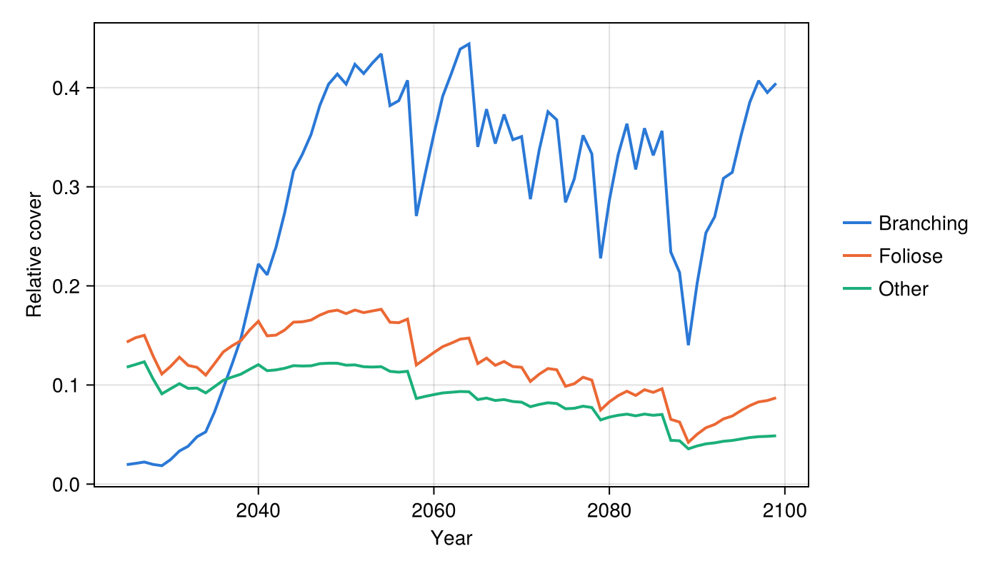
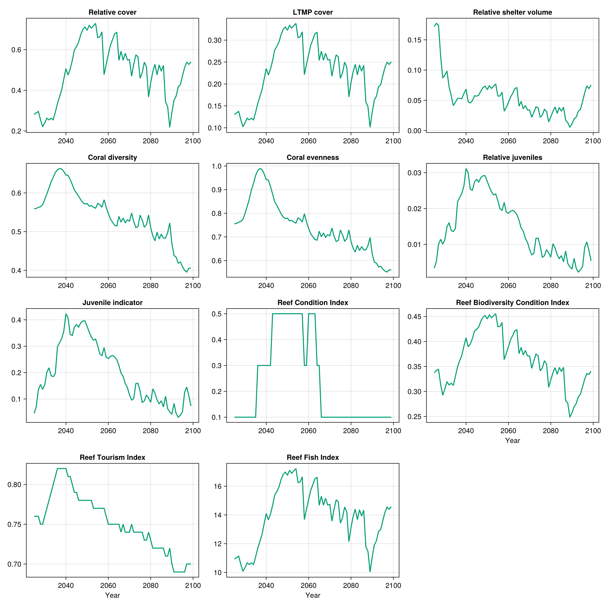

# CoralPOP

CoralPOP is a [coral population model](https://doi.org/10.1016/j.ecolmodel.2026.111672)
written in Python. This example illustrates how ADRIAIndicators can be used with models that
were neither developed by nor affiliated with the Reef Restoration and Adaptation Program.

This example reads the saved output of one CoralPOP run on a synthetic one-reef domain
(2025-2099), puts it into the layout ADRIAIndicators expects, and calculates the cover,
shelter volume, diversity, juvenile and composite index metrics.

Note: To run the following code, NPZ.jl should be added to the environment.

The output file and the reef are synthetic, so the resulting metrics are illustrative only.
To run the code, download the files from the
[`docs/examples/coral_models`](https://github.com/open-AIMS/ADRIAIndicators.jl/tree/main/docs/examples/coral_models)
folder of the ADRIAIndicators.jl repository.

```julia
using NPZ

import ADRIAIndicators as AI
```

## 1. CoralPOP output

CoralPOP returns a set of NumPy arrays for each run in `npz` format.

The array used for this example is `surface_area_m2`, which is the planar area of all
colonies in m² of the whole reef, with dimensions `[time ⋅ size bin ⋅ morphology ⋅ site]`.
In the snippet below, these are of shape `[75 ⋅ 20 ⋅ 3 ⋅ 1]`. CoralPOP outputs always place
the site/location dimension last. The `time` axis covers the years 2025-2099 with the first
being the initial state. The three morphologies are Branching, Foliose and Other, and the 20
size bins are 5 cm wide. The output does not record the reef's area, so the total and
habitable area are taken from the description of the spatial domain.

```julia
habitable_area_m2 = [38910.4]  # [locations], m²
reef_area_m2 = [83897.0]       # [locations], m², includes non-habitable area

# NPZ.jl cannot read the file's text array, so request the array that is needed
area_m2 = npzread("data/coralpop/scenario_1.npz", ["surface_area_m2"])["surface_area_m2"]
size(area_m2)  # (75, 20, 3, 1)
```

## 2. Adapting the output to ADRIAIndicators

ADRIAIndicators expects *relative* cover (a proportion of habitable area) with dimensions
`[timesteps ⋅ groups ⋅ sizes ⋅ locations]`. The area only needs reordering and dividing by
the habitable area. The diameters are computed from the size bin edges,
and the first two bins (colonies under 10 cm) are taken as the juveniles.

```julia
rel_cover = permutedims(area_m2, (1, 3, 2, 4)) ./ reshape(habitable_area_m2, 1, 1, 1, :)

n_groups, n_sizes = 3, 20
bin_cm = 5.0

# Colony diameter (cm) of each size bin, the root mean square of its edges [groups ⋅ sizes]
bin_diameter(b) = sqrt(((b - 1) * bin_cm)^2 / 2 + (b * bin_cm)^2 / 2)
diam_cm = repeat(reshape(bin_diameter.(1:n_sizes), 1, n_sizes), n_groups, 1)

# Which group and size class combinations are juvenile [groups ⋅ sizes]
is_juvenile = falses(n_groups, n_sizes)
is_juvenile[:, 1:2] .= true
```

## 3. Indicators

Shelter volume needs the colony diameters (cm) and the parameters of a log-log planar area
model for each group and size class. Here every group uses the same illustrative values; the
[in-depth example](../examples/cscape_coralpop.md) maps CoralPOP's groups onto ADRIA's
functional group parameters.

```julia
n_groups, n_sizes = size(diam_cm)

planar_area_params = zeros(Float64, n_groups, n_sizes, 2)  # [groups ⋅ sizes ⋅ (intercept, coefficient)]
planar_area_params[:, :, 1] .= -8.95  # intercept
planar_area_params[:, :, 2] .= 2.80   # coefficient

# Reference colony defining the maximum shelter volume: (diameter cm, intercept, coefficient)
reference = (95.0, -8.95, 2.80)

max_juvenile_density = 15.0  # individuals/m²
```

```julia
# Cover [timesteps ⋅ locations]
relative_cover = AI.relative_cover(rel_cover)
ltmp_cover = AI.ltmp_cover(rel_cover, habitable_area_m2, reef_area_m2)

# Shelter volume, summed over groups and sizes [timesteps ⋅ locations]
rsv = AI.relative_shelter_volume(
    rel_cover, diam_cm, planar_area_params, habitable_area_m2, reference
)
total_rsv = clamp.(dropdims(sum(rsv; dims=(2, 3)); dims=(2, 3)), 0.0, 1.0)

# Diversity, from the cover of each group [timesteps ⋅ groups ⋅ locations]
relative_loc_taxa_cover = AI.relative_loc_taxa_cover(rel_cover)
coral_diversity = AI.coral_diversity(relative_loc_taxa_cover)
coral_evenness = AI.coral_evenness(relative_loc_taxa_cover)

# Juveniles. Note that mean colony diameters are expected in m here, whereas the
# shelter volume functions take cm.
relative_juveniles = AI.relative_juveniles(rel_cover, is_juvenile)
juvenile_indicator = AI.juvenile_indicator(
    rel_cover, is_juvenile, habitable_area_m2, diam_cm ./ 100, max_juvenile_density
)
```

CoralPOP does not model rubble, so only the composite indices that do not need it are used.

```julia
reef_condition_index = AI.reef_condition_index(ltmp_cover, total_rsv, juvenile_indicator)

reef_biodiversity_condition_index = AI.reef_biodiversity_condition_index(
    relative_cover, coral_diversity, total_rsv
)

reef_tourism_index = AI.reef_tourism_index_no_rubble(
    ltmp_cover, coral_evenness, total_rsv, relative_juveniles
)

reef_fish_index = AI.reef_fish_index(relative_cover)
```

## 4. Results

```julia
final_values = [
    "Relative cover" => relative_cover,
    "LTMP cover" => ltmp_cover,
    "Relative shelter volume" => total_rsv,
    "Coral diversity" => coral_diversity,
    "Coral evenness" => coral_evenness,
    "Relative juveniles" => relative_juveniles,
    "Juvenile indicator" => juvenile_indicator,
    "Reef Condition Index" => reef_condition_index,
    "Reef Biodiversity Condition Index" => reef_biodiversity_condition_index,
    "Reef Tourism Index" => reef_tourism_index,
    "Reef Fish Index" => reef_fish_index
]

println("Final timestep:")
for (name, metric) in final_values
    println(rpad(name, 35), round.(metric[end, :]; digits=3))
end
```

## 5. Plots

The metrics are plain arrays, so any plotting package can be used; [`Makie.jl`](https://docs.makie.org)
is shown here. This code is not run when the documentation is built: the images below are
produced by running this whole page's code with
[`docs/figures/coralpop_figures.jl`](https://github.com/open-AIMS/ADRIAIndicators.jl/blob/main/docs/figures/coralpop_figures.jl).

```julia
using CairoMakie

years = 2025:2099
morphologies = ["Branching", "Foliose", "Other"]
group_colors = ["#2a78d6", "#eb6834", "#1baf7a"]

# Relative cover of each morphology
fig_groups = Figure(size=(700, 400))
ax_groups = Axis(fig_groups[1, 1]; xlabel="Year", ylabel="Relative cover")
for g in 1:n_groups
    lines!(ax_groups, years, relative_loc_taxa_cover[:, g, 1]; color=group_colors[g], linewidth=2)
end
Legend(
    fig_groups[1, 2],
    [LineElement(; color=c, linewidth=2) for c in group_colors],
    morphologies; framevisible=false
)

# Every metric of the results above, one panel per metric
fig_metrics = Figure(size=(1200, 1200))
for (i, (name, metric)) in enumerate(final_values)
    ax = Axis(
        fig_metrics[fld1(i, 3), mod1(i, 3)]; title=name,
        xlabel=i > length(final_values) - 3 ? "Year" : ""
    )
    lines!(ax, years, metric[:, 1]; color="#009E73", linewidth=2)
end
```



Cover of each morphology over time. Branching colonies come to dominate, then lose cover
after the strong heat events (around 2058 and 2087-2089) and recover.



All metrics over time.

This is one default run of CoralPOP, so it shows the model's trajectory, not its
uncertainty. [Comparing C~scape and CoralPOP](../examples/cscape_coralpop.md) calculates the
same metrics for C~scape, run under the same heat stress, and compares the two models. It also
checks the results against each model's own cover and lists the most common pitfalls when
adapting an output.
