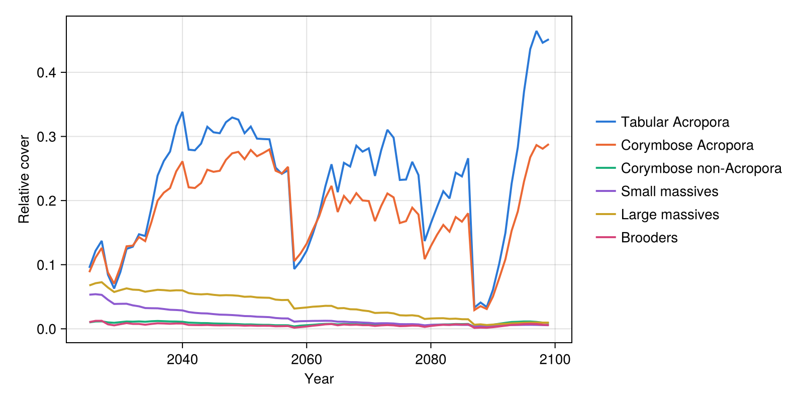
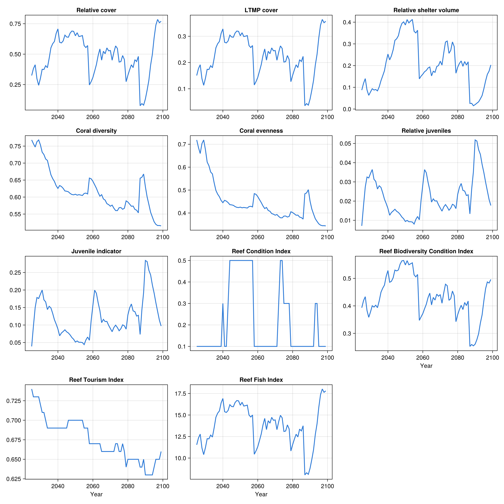

# C~scape

C~scape is an integral-projection model of coral colony size classes written in R. This
example reads the saved output of one C~scape run on a synthetic one-reef domain
(2025-2099), puts it into the layout ADRIAIndicators expects, and calculates the cover,
shelter volume, diversity, juvenile and composite index metrics.

Note: To run the following code, RData.jl should be added to the environment.

The output file and the reef are synthetic, so the resulting metrics are illustrative only.
To run the code, download the files from the
[`docs/examples/coral_models`](https://github.com/open-AIMS/ADRIAIndicators.jl/tree/main/docs/examples/coral_models)
folder of the ADRIAIndicators.jl repository.

```julia
using RData

import ADRIAIndicators as AI
```

## 1. C~scape output

C~scape saves one `.rds` file per run, holding one six-dimensional array of `[year ⋅ site ⋅
intervened ⋅ type ⋅ enhancement ⋅ value]`. The file stores the names of the dimensions, but
`RData.jl` returns a plain array without them, so the code below selects each dimension by
its position in that order. The 100 size classes are in value slots 7-106 and are colony
*counts*, so converting to cover needs the diameter of each class, and which classes are
juvenile. Both belong to the demography of each type, and are stored in `size_classes.rds`.

The output does not record the reef's area either, so the total and habitable area are taken
from the domain description.

```julia
habitable_area_m2 = [38910.4]  # [locations], m²
reef_area_m2 = [83897.0]       # [locations], m², includes non-habitable area

types = ["acro_table", "acro_corym", "corym_non_acro", "small_massive", "large_massive", "brooder"]
size_classes = RData.load("data/cscape/size_classes.rds")

# Colony diameter (cm) and juvenile classes [groups ⋅ sizes]
diam_cm = permutedims(reduce(hcat, [Float64.(size_classes[t]["meshpoints_diam"]) for t in types]))
is_juvenile = permutedims(reduce(hcat, [Bool.(size_classes[t]["juvenile"]) for t in types]))

out = RData.load("data/cscape/Array_scenario_101000100001_rep_1_draw_NA.rds")
size(out)  # (76, 1, 2, 6, 14, 107)
```

## 2. Adapting the output to ADRIAIndicators

ADRIAIndicators expects *relative* cover (a proportion of habitable area) with dimensions
`[timesteps ⋅ groups ⋅ sizes ⋅ locations]`. The first year is the initial state, so it is
dropped. The `intervened` sub-areas and the 14 enhancement classes are summed, and counts are
converted to cover: a colony of diameter *d* cm has a planar area of π(*d*/200)² m².

```julia
# [timesteps ⋅ locations ⋅ groups ⋅ sizes]
counts = dropdims(sum(out[2:end, :, :, :, :, 7:106]; dims=(3, 5)); dims=(3, 5))
counts = permutedims(counts, (1, 3, 4, 2))  # [timesteps ⋅ groups ⋅ sizes ⋅ locations]

colony_area_m2 = π .* (diam_cm ./ 200) .^ 2
rel_cover = counts .* reshape(colony_area_m2, 1, size(colony_area_m2)...) ./
            reshape(habitable_area_m2, 1, 1, 1, :)
```

## 3. Indicators

Shelter volume needs the colony diameters (cm) and the parameters of a log-log planar area
model for each group and size class. Here every group uses the same illustrative values; the
[in-depth example](../examples/cscape_coralpop.md) maps C~scape's groups onto ADRIA's
functional group parameters.

```julia
n_groups, n_sizes = size(diam_cm)

planar_area_params = zeros(Float64, n_groups, n_sizes, 2)  # [groups ⋅ sizes ⋅ (intercept, coefficient)]
planar_area_params[:, :, 1] .= -8.95  # intercept
planar_area_params[:, :, 2] .= 2.80   # coefficient

# Reference colony defining the maximum shelter volume: (diameter cm, intercept, coefficient)
reference = (95.0, -8.95, 2.80)

max_juvenile_density = 15.0  # individuals/m²
```

```julia
# Cover [timesteps ⋅ locations]
relative_cover = AI.relative_cover(rel_cover)
ltmp_cover = AI.ltmp_cover(rel_cover, habitable_area_m2, reef_area_m2)

# Shelter volume, summed over groups and sizes [timesteps ⋅ locations]
rsv = AI.relative_shelter_volume(
    rel_cover, diam_cm, planar_area_params, habitable_area_m2, reference
)
total_rsv = clamp.(dropdims(sum(rsv; dims=(2, 3)); dims=(2, 3)), 0.0, 1.0)

# Diversity, from the cover of each group [timesteps ⋅ groups ⋅ locations]
relative_loc_taxa_cover = AI.relative_loc_taxa_cover(rel_cover)
coral_diversity = AI.coral_diversity(relative_loc_taxa_cover)
coral_evenness = AI.coral_evenness(relative_loc_taxa_cover)

# Juveniles. Note that mean colony diameters are expected in m here, whereas the
# shelter volume functions take cm.
relative_juveniles = AI.relative_juveniles(rel_cover, is_juvenile)
juvenile_indicator = AI.juvenile_indicator(
    rel_cover, is_juvenile, habitable_area_m2, diam_cm ./ 100, max_juvenile_density
)
```

C~scape does not model rubble, so only the composite indices that do not need it are used.

```julia
reef_condition_index = AI.reef_condition_index(ltmp_cover, total_rsv, juvenile_indicator)

reef_biodiversity_condition_index = AI.reef_biodiversity_condition_index(
    relative_cover, coral_diversity, total_rsv
)

reef_tourism_index = AI.reef_tourism_index_no_rubble(
    ltmp_cover, coral_evenness, total_rsv, relative_juveniles
)

reef_fish_index = AI.reef_fish_index(relative_cover)
```

## 4. Results

```julia
final_values = [
    "Relative cover" => relative_cover,
    "LTMP cover" => ltmp_cover,
    "Relative shelter volume" => total_rsv,
    "Coral diversity" => coral_diversity,
    "Coral evenness" => coral_evenness,
    "Relative juveniles" => relative_juveniles,
    "Juvenile indicator" => juvenile_indicator,
    "Reef Condition Index" => reef_condition_index,
    "Reef Biodiversity Condition Index" => reef_biodiversity_condition_index,
    "Reef Tourism Index" => reef_tourism_index,
    "Reef Fish Index" => reef_fish_index
]

println("Final timestep:")
for (name, metric) in final_values
    println(rpad(name, 35), round.(metric[end, :]; digits=3))
end
```

## 5. Plots

The metrics are plain arrays, so any plotting package can be used; [`Makie.jl`](https://docs.makie.org)
is shown here. This code is not run when the documentation is built: the images below are
produced by running this whole page's code with
[`docs/figures/cscape_figures.jl`](https://github.com/open-AIMS/ADRIAIndicators.jl/blob/main/docs/figures/cscape_figures.jl).

```julia
using CairoMakie

years = 2025:2099
group_names = ["Tabular Acropora", "Corymbose Acropora", "Corymbose non-Acropora",
    "Small massives", "Large massives", "Brooders"]
group_colors = ["#2a78d6", "#eb6834", "#1baf7a", "#8e5bd0", "#c9a227", "#d6457a"]

# Relative cover of each coral type
fig_groups = Figure(size=(800, 400))
ax_groups = Axis(fig_groups[1, 1]; xlabel="Year", ylabel="Relative cover")
for g in 1:n_groups
    lines!(ax_groups, years, relative_loc_taxa_cover[:, g, 1]; color=group_colors[g], linewidth=2)
end
Legend(
    fig_groups[1, 2],
    [LineElement(; color=c, linewidth=2) for c in group_colors],
    group_names; framevisible=false
)

# Every metric of the results above, one panel per metric
fig_metrics = Figure(size=(1200, 1200))
for (i, (name, metric)) in enumerate(final_values)
    ax = Axis(
        fig_metrics[fld1(i, 3), mod1(i, 3)]; title=name,
        xlabel=i > length(final_values) - 3 ? "Year" : ""
    )
    lines!(ax, years, metric[:, 1]; color="#2a78d6", linewidth=2)
end
```



Cover of each coral type over time. Tabular and corymbose *Acropora* carry nearly all the
cover, lose most of it in the strong heat events (around 2058 and 2087-2089) and recover.



All metrics over time.

This is one default run of C~scape, so it shows the model's trajectory, not its
uncertainty. [Comparing C~scape and CoralPOP](../examples/cscape_coralpop.md) calculates the
same metrics for CoralPOP, run under the same heat stress, and compares the two models. It also
checks the results against each model's own cover and lists the most common pitfalls when
adapting an output.
