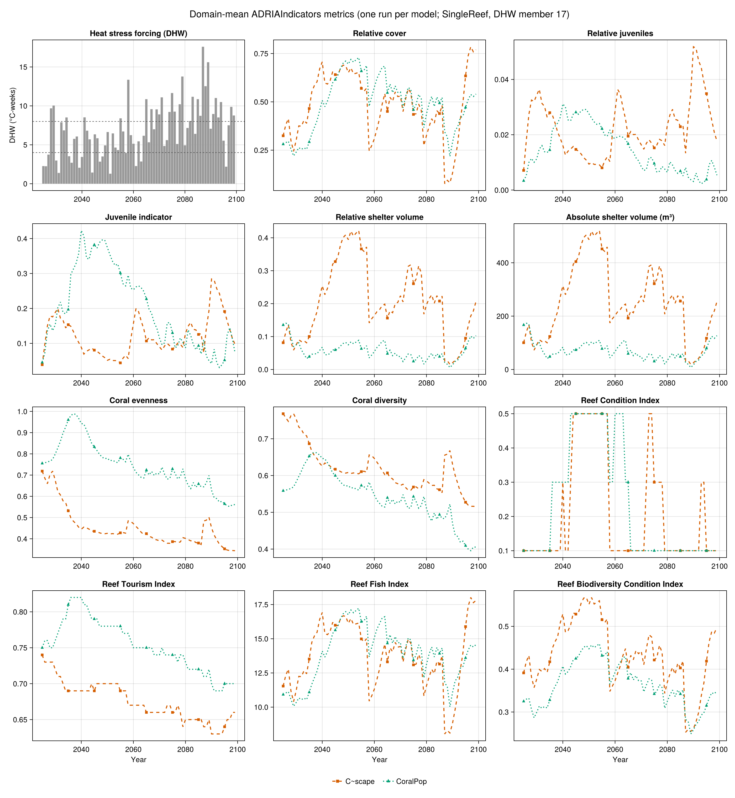

# C~scape and CoralPop

This example applies ADRIAIndicators to the **saved output files of two coral models whose
outputs look nothing alike**: C~scape, an R integral-projection model that saves an `.rds`
array of colony counts, and CoralPop, a Python population model that saves NumPy `.npz`
arrays of colony surface area. Each was run once, with its default parameters, on the same
synthetic one-reef domain (`SingleReef`, 2025-2099) under a strong heat-stress series. The
only model-specific work is a reader that puts each model's output into the layout
ADRIAIndicators expects. Everything after that is identical for both models.

The example runs the models' saved output, not the models themselves. The output files and
the complete runnable code, including a longer walk-through, are in
[`examples/coral_models`](https://github.com/open-AIMS/ADRIAIndicators.jl/tree/main/examples/coral_models).
The reef is synthetic, so the resulting metrics are illustrative only.

Note: To run the code in this example, RData.jl, NPZ.jl and CairoMakie.jl should be added to
the environment. `examples/coral_models/Project.toml` has them.

## 1. Model outputs

Both models were forced with the same heat stress (degree heating weeks, DHW, in
°C-weeks) and start from the same initial cover. Neither output file records the area of the
reef, which is needed to turn the models' quantities into cover relative to the habitable
area, so the reef's total and habitable area are read from a small table.

### C~scape

C~scape saves one `.rds` file per run (`Array_scenario_<id>_rep_<rep>_draw_<draw>.rds`; here
`draw_NA`, the median over the posterior draws of the fitted demography). It holds one
six-dimensional array. R keeps the names of the dimensions, the Julia reader does not return
them, so the order matters:

```julia
using RData

a = RData.load("data/cscape/Array_scenario_101000100001_rep_1_draw_NA.rds")
size(a)  # (76, 1, 2, 6, 14, 107)
```

| Dimension | Length | Meaning |
|:----------|:-------|:--------|
| `year` | 76 | 2024 ... 2099. Slot 1 is the **initial state**, labelled one year before the first simulated year |
| `reef_siteid` | 1 | sites of the domain |
| `intervened` | 2 | `"no"` / `"yes"`: the part of each site without and with a coral deployment. Empty here for `"yes"` |
| `ft` | 6 | coral types: tabular *Acropora*, corymbose *Acropora*, corymbose non-*Acropora*, small massives, large massives, brooders |
| `enhancement` | 14 | heat-tolerance classes. A type's population is the sum over the classes |
| `value` | 107 | slot 1: cover, **% of the site area**. Slots 2-6: early life stages. **Slots 7-106: the 100 size classes, as numbers of colonies**. Slot 107: unused |

The size classes are *counts* of colonies, so converting them to cover needs the diameter of
each class. The diameters, and which classes are juvenile (those without fecundity), belong
to the demography of each type and not to the output file, so they are stored in
`size_classes.rds`.

### CoralPop

CoralPop's engine returns a set of NumPy arrays for each run, and `numpy.savez` stores them
unchanged. The site dimension is always last.

| Array | Dimensions | Meaning |
|:------|:-----------|:--------|
| `surface_area_m2` | `[time ⋅ size bin ⋅ morphology ⋅ site]` (75, 20, 3, 1) | planar area of all colonies, m² of the whole reef |
| `cover_pct` | `[time ⋅ morphology ⋅ site]` | cover, % of the **reef** area |
| `benthic_pct`, `larvae_produced`, `larvae_received`, `benthic_columns` | | not used here |

The 75 rows are the years 2025-2099, row 1 being the initial state. The three morphologies
are Branching, Foliose and Other, and the 20 size bins are 5 cm wide.

## 2. Adapting the outputs to ADRIAIndicators

ADRIAIndicators expects cover relative to the habitable area with dimensions
`[timesteps ⋅ groups ⋅ sizes ⋅ locations]`, one run at a time. Each reader below returns that
cover together with what the indicators also need: the habitable and total area of each
location, the colony diameter of each group and size class, the parameters of the planar area
model used for shelter volume, and which group and size classes are juvenile.

```julia
include(joinpath(@__DIR__, "src", "adapters.jl"))
include(joinpath(@__DIR__, "src", "pipeline.jl"))
import CairoMakie as Mk
using Printf

const DATA_DIR = joinpath(@__DIR__, "data")
const OUT_DIR = mkpath(joinpath(@__DIR__, "output"))
```

The reef's areas and the heat stress are read first.

```julia
# ===== STEP 1: the reef and its heat stress =====

reef = read_reef(joinpath(DATA_DIR, "domain", "singlereef_domain.csv"))
dhw_table, dhw_header = readdlm(joinpath(DATA_DIR, "domain", "dhw_member17.csv"), ','; header=true)
YEARS = collect(2025:2099)
dhw = Float64.(dhw_table[:, findfirst(==("dhw"), vec(dhw_header))])      # one reef: one DHW value per year
@assert Int.(dhw_table[:, 1]) == YEARS
```

```julia
# ===== The reef both models were run on =====

"""
    read_reef(path) -> NamedTuple

The one-reef domain the models ran on: location id, total reef area (m2) and habitable ("k") area (m2). Neither
model's output file contains these, and ADRIAIndicators needs both, so they are read from the domain description.
"""
function read_reef(path::AbstractString)
    data, header = readdlm(path, ','; header=true)
    col(name) = data[:, findfirst(==(name), vec(header))]
    return (; ids=String.(col("location_id")), reef_area=Float64.(col("reef_area_m2")), k_area=Float64.(col("k_area_m2")))
end
```

### C~scape: counts to cover

`read_cscape` drops the initial-state slot, keeps the 100 size-class slots, adds up the two
`intervened` sub-areas and the 14 heat classes, and converts counts to cover: a colony of
diameter *d* cm has a planar area of π(*d*/200)² m², so cover is count × colony area ÷
habitable area.

```julia
# ===== C~scape =====

const CSCAPE_TYPES = ["acro_table", "acro_corym", "corym_non_acro", "small_massive", "large_massive", "brooder"]
const CSCAPE_SIZE_SLOTS = 7:106        # value slots 7..106 of out_array hold the 100 size classes (colony COUNTS)

"""
    read_cscape(dir, reef; years) -> NamedTuple

Read every `Array_scenario_*.rds` in `dir` (one file per run, sorted by scenario id).
"""
function read_cscape(dir::AbstractString, reef; years=2025:2099)
    files = filter(f -> occursin(r"^Array_scenario_.*\.rds$", f), readdir(dir))
    sort!(files; by=f -> parse(Int, match(r"scenario_(\d+)", f).captures[1]))
    sc = RData.load(joinpath(dir, "size_classes.rds"))
    d_cm = permutedims(reduce(hcat, [Float64.(sc[ft]["meshpoints_diam"]) for ft in CSCAPE_TYPES]))   # [6, 100]
    juvenile = permutedims(reduce(hcat, [Bool.(sc[ft]["juvenile"]) for ft in CSCAPE_TYPES]))         # [6, 100]
    G, S = size(d_cm)
    L, N = length(reef.ids), length(files)

    colony_area_m2 = π .* (d_cm ./ 200) .^ 2                       # diameter in cm -> radius in m -> area in m2
    cover = zeros(length(years), G, S, L, N)
    for (n, f) in enumerate(files)
        out = RData.load(joinpath(dir, f))                         # [year, site, intervened, type, heat class, value]
        size(out) == (length(years) + 1, L, 2, G, 14, 107) || error("$f has unexpected shape $(size(out))")
        ## counts: skip slot 1 (2024), keep the 100 size classes, add the two `intervened` sub-areas and the 14 heat classes
        counts = dropdims(sum(out[2:end, :, :, :, :, CSCAPE_SIZE_SLOTS]; dims=(3, 5)); dims=(3, 5))   # [T, L, G, S]
        counts = permutedims(counts, (1, 3, 4, 2))                                                    # [T, G, S, L]
        cover[:, :, :, :, n] = clamp.(counts .* reshape(colony_area_m2, 1, G, S, 1) ./ reshape(reef.k_area, 1, 1, 1, L), 0, 1)
    end
    return (; label="C~scape", years=collect(years), groups=CSCAPE_TYPES, locations=reef.ids, cover,
        k_area=reef.k_area, reef_area=reef.reef_area, diam_cm=repeat(d_cm, 1, 1, N),
        pap=planar_area_for([1, 2, 3, 4, 5, 3], S), is_juvenile=juvenile)          # brooders use the corymbose non-Acropora row
end
```

### CoralPop: area to cover

CoralPop already stores an area, so `read_coralpop` divides it by the habitable area, moves
the dimensions into the expected order, computes the bin diameters from the bin edges and
takes the first two bins (colonies under 10 cm) as the juveniles.

```julia
# ===== CoralPop =====

const CORALPOP_MORPHS = ["Branching", "Foliose", "Other"]
const CORALPOP_BIN_CM = 5.0            # 20 size bins of 5 cm

"Mean colony diameter (cm) of CoralPop's size bin `b` (1-based), as the engine computes it: sqrt(lo^2/2 + hi^2/2)."
coralpop_bin_diameter(b; bin=CORALPOP_BIN_CM) = sqrt(((b - 1) * bin)^2 / 2 + (b * bin)^2 / 2)

"""
    read_coralpop(dir, reef) -> NamedTuple

Read every `scenario_*.npz` in `dir`. The 75 rows of the engine's time axis are the years 2025-2099.
"""
function read_coralpop(dir::AbstractString, reef; years=2025:2099)
    files = filter(f -> occursin(r"^scenario_\d+\.npz$", f), readdir(dir))
    sort!(files; by=f -> parse(Int, match(r"scenario_(\d+)", f).captures[1]))
    B, M = 20, length(CORALPOP_MORPHS)
    L, N = length(reef.ids), length(files)

    cover = zeros(length(years), M, B, L, N)
    for (n, f) in enumerate(files)
        ## NPZ.jl cannot read the file's text array (benthic_columns), so ask for the array we need
        area = npzread(joinpath(dir, f), ["surface_area_m2"])["surface_area_m2"]    # [T, bin, morph, site], m2
        size(area) == (length(years), B, M, L) || error("$f has unexpected shape $(size(area))")
        cover[:, :, :, :, n] = clamp.(permutedims(area, (1, 3, 2, 4)) ./ reshape(reef.k_area, 1, 1, 1, L), 0, 1)
    end
    d_cm = repeat(reshape([coralpop_bin_diameter(b) for b in 1:B], 1, B), M, 1)       # [morph, bin]
    juvenile = falses(M, B)
    juvenile[:, 1:2] .= true                                                          # bins 1-2: colonies < 10 cm
    return (; label="CoralPop", years=collect(years), groups=CORALPOP_MORPHS, locations=reef.ids, cover,
        k_area=reef.k_area, reef_area=reef.reef_area, diam_cm=repeat(d_cm, 1, 1, N),
        pap=planar_area_for([2, 1, 5], B), is_juvenile=juvenile)                      # Branching, Foliose, Other -> ADRIA rows 2, 1, 5
end
```

Shelter volume needs the parameters of a log-log planar area model for each group. Both
models use the five functional groups' parameters of ADRIA, and the only decision is which
row each model's group takes. Here CoralPop's Branching, Foliose and Other morphologies take
the corymbose *Acropora*, tabular *Acropora* and large massives rows, and C~scape's brooders
the corymbose non-*Acropora* row.

```julia
# ===== Planar-area parameters (shelter volume) =====

## log(S) = b + a log(x), (b, a) per ADRIA functional group -- Aston et al. (2022), as ADRIA.planar_area_params().
## Rows: tabular Acropora, corymbose Acropora, corymbose non-Acropora, small massives, large massives.
const PLANAR_AREA = [
    -8.95 2.80
    -9.13 2.94
    -8.90 2.94
    -8.87 2.30
    -8.87 2.30
]

"[groups, sizes, 2] planar-area parameters when group `g` uses ADRIA row `rows[g]`, the same for every size class."
planar_area_for(rows, n_sizes) = repeat(reshape(PLANAR_AREA[rows, :], length(rows), 1, 2), 1, n_sizes, 1)
```

Both models are now read:

```julia
# ===== STEP 2: read each model's own output files =====

cscape = read_cscape(joinpath(DATA_DIR, "cscape"), reef; years=YEARS)
coralpop = read_coralpop(joinpath(DATA_DIR, "coralpop"), reef; years=YEARS)
```

## 3. Indicators

From here on nothing is specific to either model. The indicators are calculated for each run
and then aggregated over the locations.

```julia
# ===== constants both models share =====

## Reference colony that relative shelter volume is scaled against: one tabular Acropora of 95 cm
## diameter per m2, given as (diameter in cm, intercept b, coefficient a) of log(S) = b + a log(x).
## This is ADRIA's convention; it is what makes shelter volume comparable between models.
const SV_REFERENCE = (95.0, -8.95, 2.80)

## Juvenile density (colonies per m2) at which the juvenile indicator reaches 1 (ADRIA's value).
const MAX_JUVENILE_DENSITY = 15.0
```

ADRIAIndicators is organised in layers, which is how the calculation is built: cover
collapses the group and size dimensions; shelter volume and juveniles need the diameters,
planar area parameters and juvenile flags; diversity works on the cover of each group; and
the composite indices combine these metrics. Neither model has rubble, so the indices that
do not need it are used. Note that the shelter volume functions take colony diameters in cm,
whereas the juvenile indicator takes them in m.

```julia
# ===== the indicators, per location and run =====

## (key, title shown on the figure)
const METRICS = [
    (:relative_cover, "Relative cover"),
    (:relative_juveniles, "Relative juveniles"),
    (:juvenile_indicator, "Juvenile indicator"),
    (:relative_shelter_volume, "Relative shelter volume"),
    (:absolute_shelter_volume, "Absolute shelter volume (m³)"),
    (:coral_evenness, "Coral evenness"),
    (:coral_diversity, "Coral diversity"),
    (:reef_condition_index, "Reef Condition Index"),
    (:reef_tourism_index, "Reef Tourism Index"),
    (:reef_fish_index, "Reef Fish Index"),
    (:reef_biodiversity_condition_index, "Reef Biodiversity Condition Index"),
]

"""
    compute_indicators(m) -> Dict{Symbol,Array{Float64,3}}

Every indicator of `METRICS` as a `[timesteps, locations, runs]` array, using only ADRIAIndicators.
ADRIAIndicators works on one run at a time (`[T, G, S, L]`), so this loops over the runs.
"""
function compute_indicators(m)
    T, G, S, L, N = size(m.cover)
    out = Dict{Symbol,Array{Float64,3}}(k => zeros(T, L, N) for (k, _) in METRICS)

    for n in 1:N
        cover = m.cover[:, :, :, :, n]                                  # [T, G, S, L]
        diam_cm = m.diam_cm[:, :, n]                                    # [G, S]

        ## -- cover --
        rc = AI.relative_cover(cover)                                   # [T, L]  all groups and sizes
        taxa = AI.relative_loc_taxa_cover(cover)                        # [T, G, L]  per group
        ltmp = AI.ltmp_cover(cover, m.k_area, m.reef_area)              # [T, L]  relative to REEF area

        ## -- shelter volume: ADRIAIndicators returns it per group / size class; add them up and,
        ##    for the relative version, clamp to [0, 1] (the metric's definition) --
        rsv = AI.relative_shelter_volume(cover, diam_cm, m.pap, m.k_area, SV_REFERENCE)
        rsv = clamp.(dropdims(sum(rsv; dims=(2, 3)); dims=(2, 3)), 0.0, 1.0)             # [T, L]
        asv = AI.absolute_shelter_volume(cover, diam_cm, m.pap, m.k_area)
        asv = dropdims(sum(asv; dims=(2, 3)); dims=(2, 3))                               # [T, L], m3

        ## -- juveniles. NOTE the unit: the indicator needs diameters in METRES, shelter volume in CM --
        rjuv = AI.relative_juveniles(cover, m.is_juvenile)              # [T, L]
        jind = AI.juvenile_indicator(cover, m.is_juvenile, m.k_area, diam_cm ./ 100.0, MAX_JUVENILE_DENSITY)

        ## -- diversity --
        even = AI.coral_evenness(taxa)                                  # [T, L]
        div = AI.coral_diversity(taxa)                                  # [T, L]

        ## -- indices built from the metrics above (no rubble: neither model has it) --
        rci = AI.reef_condition_index(ltmp, rsv, jind)
        rti = AI.reef_tourism_index_no_rubble(ltmp, even, rsv, rjuv)
        rfi = AI.reef_fish_index(rc)
        rbci = AI.reef_biodiversity_condition_index(rc, div, rsv)

        for (k, v) in (:relative_cover => rc, :relative_juveniles => rjuv, :juvenile_indicator => jind,
            :relative_shelter_volume => rsv, :absolute_shelter_volume => asv, :coral_evenness => even,
            :coral_diversity => div, :reef_condition_index => rci, :reef_tourism_index => rti,
            :reef_fish_index => rfi, :reef_biodiversity_condition_index => rbci)
            out[k][:, :, n] .= v
        end
    end
    return out
end
```

```julia
# ===== from locations to the domain =====

"""
    domain_metrics(m, ind) -> Dict{Symbol,Matrix{Float64}}

Collapse the location dimension of every indicator: the k-area weighted mean (each location counts in
proportion to its habitable area) -- or, for the one absolute quantity (shelter volume in m3), the sum.
Result: `[timesteps, runs]`. With a single location both are the location's own value.
"""
function domain_metrics(m, ind)
    return Dict(k => k === :absolute_shelter_volume ?
                     AI.scenario_metric(v, m.k_area, 2; is_relative=false, return_relative=false) :
                     AI.scenario_metric(v, m.k_area, 2)
                for (k, v) in ind)
end
```

```julia
# ===== STEP 3: check the standard layout, then compute the indicators =====

models = (cscape, coralpop)
results = map(models) do m
    check_model(m)
    ind = compute_indicators(m)                       # [timesteps, locations, runs]
    dom = domain_metrics(m, ind)                      # [timesteps, runs]
    @info "$(m.label): $(size(m.cover, 5)) run, $(size(m.cover, 4)) location(s), " *
          "$(length(m.years)) years ($(first(m.years))-$(last(m.years)))"
    (; m, ind, dom)
end
```

## 4. Checking the readers

A reader that mishandles a unit does not fail, it silently returns wrong numbers. Each model
also stores its own total cover, in different units (C~scape in % of the site area, CoralPop
in % of the reef area). Converting that to relative cover and comparing it with the cover
the readers produced catches such mistakes:

```
Relative cover recomputed from the colony data vs the model's own cover (max |difference|):
  C~scape   all years 7.77e-16   years 2026-2099 7.77e-16
  CoralPop  all years 1.19e-06   years 2026-2099 3.33e-16
```

The two agree to rounding. The exception is CoralPop's first year: its `cover_pct` is the
cover the engine was given as input, whereas its `surface_area_m2` is rebuilt from the
initial size distribution. The code is in `examples/coral_models/src/adapters.jl`.

## 5. Results

The heat stress, and each indicator of both models over time:



Values in 2099:

| Metric | C~scape | CoralPop |
|:-------|--------:|---------:|
| Relative cover | 0.770 | 0.540 |
| Relative juveniles | 0.0177 | 0.0054 |
| Juvenile indicator | 0.097 | 0.073 |
| Relative shelter volume | 0.207 | 0.103 |
| Absolute shelter volume (m³) | 255 | 127 |
| Coral evenness | 0.344 | 0.561 |
| Coral diversity | 0.515 | 0.406 |
| Reef Condition Index | 0.1 | 0.1 |
| Reef Tourism Index | 0.66 | 0.70 |
| Reef Fish Index | 17.8 | 14.6 |
| Reef Biodiversity Condition Index | 0.497 | 0.350 |

Cover of each model's own functional groups helps to read the diversity and evenness
differences:


- Both models follow the heat stress. Cover rises to 0.65-0.75 of the habitable area by
  2050-2054, then drops after the strong events of 2058 and 2087-2089. C~scape loses more in
  each event (to 0.25, then 0.08) than CoralPop (to 0.48, then 0.34).
- They recover differently: C~scape's cover returns to 0.77 by 2099, carried by tabular and
  corymbose *Acropora*, whereas CoralPop's reaches 0.54, mostly as branching colonies.
- Indicators that depend on size and group differ most. Shelter volume is higher in C~scape
  for most of the run, the juvenile indicator is higher in CoralPop until about 2060, and
  evenness is lower in C~scape because two of its six groups carry nearly all cover.
- This is one default run of each model: it shows each model's trajectory, not its
  uncertainty.

## 6. Pitfalls

1. **Know what the model stored.** Counts (C~scape), m² of colony area (CoralPop), or cover in
   % of the site, reef or habitable area. ADRIAIndicators needs a proportion of the
   *habitable* area. Check against the model's own cover, as in section 4.
2. **Units.** Shelter volume takes diameters in cm and the juvenile indicator in m.
3. **The time axis.** C~scape's first slot is the initial state (2024), and its 2025 is
   already the state after one simulated year, whereas CoralPop's first row is the initial
   state (2025). Here C~scape's first slot is dropped so that both cover 2025-2099; make a
   deliberate choice in your own comparison.
4. **Juvenile definitions are model specific** (C~scape: classes without fecundity, up to
   2.7-12.4 cm depending on the type; CoralPop: colonies under 10 cm), and the largest juvenile
   diameter sets the juvenile indicator's scale.
5. **Different groups give different evenness and diversity.** C~scape has six coral types,
   CoralPop three growth forms. Compare shapes, or map both onto common groups first.
6. **Reading the files.** `RData.load` returns the C~scape array without its dimension
   names, and `NPZ.jl` cannot read the text array in CoralPop's files, so request the arrays
   you need: `npzread(file, ["surface_area_m2"])`.
