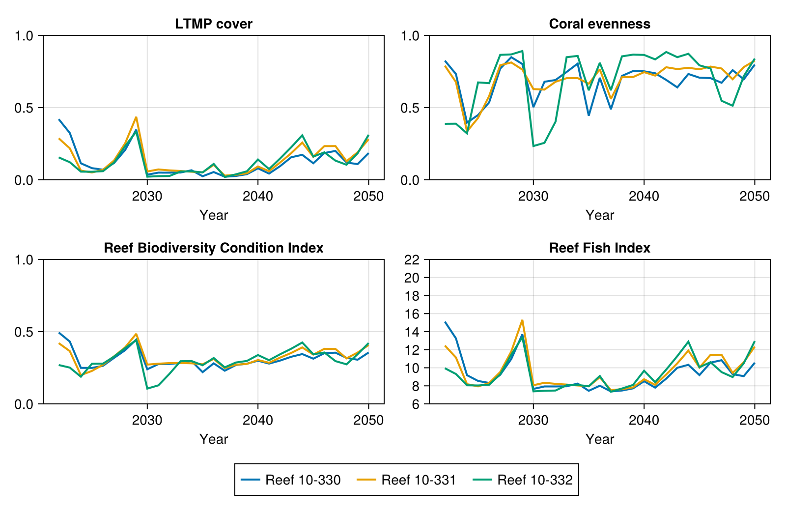

# ReefMod Engine

ReefMod Engine (RME) is a coral reef model for the Great Barrier Reef, accessed from Julia
with [ReefModEngine.jl](https://github.com/open-AIMS/ReefModEngine.jl). This example
runs RME with an outplanting intervention and uses its output to calculate the metrics that
its reef-level output supports. Unlike [CoralBlox.jl](coralblox.md), RME reports cover per
taxa without size classes, which highlights how model outputs can differ in units, dimension
order and detail.

The example is not meant to describe a real reef: RME is run with a deliberately small and
short configuration, so the values it produces should not be read as ecological projections.

Note: To run the following code, ReefModEngine.jl, CSV.jl and DataFrames.jl should be added
to the environment, together with a copy of RME, which is not distributed with
ReefModEngine.jl.

```julia
using CSV
using DataFrames
using ReefModEngine

import ADRIAIndicators as AI
```

## 1. RME simulation

This follows the ReefModEngine.jl Getting Started. RME always pairs each intervention run
with a counterfactual run.

```julia
rme_path = "path to RME directory"
init_rme(rme_path)

set_option("thread_count", 2)
set_option("use_fixed_seed", 1)
set_option("fixed_seed", 123.0)

# Reef ids and areas (km²), in the order used by RME
reef_id_list = reef_ids()
reef_area_km2 = reef_areas()

# Deploy on the first reef only
target_reef_ids = [reef_id_list[1]]
target_reef_areas_km² = reef_areas(target_reef_ids)

name = "ADRIAIndicators example"
start_year = 2022
end_year = 2050
RCP_scen = "SSP 2.45"
gcm = "CNRM_ESM2_1"
reps = 2

result_store = ResultStore(start_year, end_year)

reset_rme()

@RME runCreate(
    name::Cstring,
    start_year::Cint,
    end_year::Cint,
    RCP_scen::Cstring,
    gcm::Cstring,
    reps::Cint
)::Cint

@RME reefSetAddFromIdList(
    "iv_example"::Cstring, target_reef_ids::Ptr{Cstring}, length(target_reef_ids)::Cint
)::Cint

set_outplant_deployment!(
    "outplant_iv_2026", "iv_example", 100_000, 2026, target_reef_areas_km²
)

run_init()
@RME runProcess()::Cint

concat_results!(result_store, start_year, end_year, reps)
```

## 2. Adapting the output to ADRIAIndicators

RME output (in `result_store.results`) differs from what ADRIAIndicators expects:

| | RME | ADRIAIndicators |
|---|---|---|
| Cover | % of reef area | proportion of habitable area |
| Dimensions | `[timesteps ⋅ locations ⋅ taxa ⋅ scenarios]` | `[timesteps ⋅ groups ⋅ sizes ⋅ locations (⋅ scenarios)]` |
| Size classes | not available | required |
| Scenarios | counterfactual runs first, then intervention runs | |

Cover as a proportion of reef area is what ADRIAIndicators calls LTMP cover. The habitable
area of each reef is a fraction of its reef area. RME provides it in its `id_list` file as
the proportion of the reef that is non-grazable (sand).

```julia
# Columns: reef id, area (km²), non-grazable proportion, shelf position, CoTS cull sites
# (the file name depends on the RME version)
id_list_path = joinpath(rme_path, "data_files", "id", "id_list_2024_12_01.csv")
id_list = CSV.read(id_list_path, DataFrame; header=false, comment="#", delim=",")

# Match the id_list rows to the order of reefs used by RME
id_order = indexin(reef_id_list, uppercase.(string.(id_list[:, 1])))
@assert !any(isnothing, id_order)

habitable_fraction = 1.0 .- Float64.(id_list[id_order, 3])

reef_area_m2 = reef_area_km2 .* 1e6                       # [locations], m²
habitable_area_m2 = habitable_fraction .* reef_area_m2    # [locations], m²
habitable_area_km2 = habitable_area_m2 ./ 1e6             # [locations], km²

rme_results = result_store.results
n_timesteps = result_store.year_range
n_locations = length(reef_id_list)
n_taxa = 6
n_scenarios = 2 * reps

# Cover per taxa as a proportion of reef area, moving taxa to the dimension of groups and
# adding a single size class: [timesteps ⋅ taxa ⋅ sizes ⋅ locations ⋅ scenarios]
rme_taxa_cover = reshape(
    permutedims(Array(rme_results.total_taxa_cover.data), (1, 3, 2, 4)) ./ 100,
    n_timesteps, n_taxa, 1, n_locations, n_scenarios
)

# Convert from cover relative to reef area to cover relative to habitable area, with the
# location in dimension 4
rel_cover = AI.ltmp_cover_to_relative_cover(
    rme_taxa_cover, habitable_area_m2, reef_area_m2, 4
)

# RME stores counterfactual scenarios first, followed by intervention scenarios
cf_rel_cover = rel_cover[:, :, :, :, 1:reps]
iv_rel_cover = rel_cover[:, :, :, :, (reps + 1):end]

# Metrics without a scenario dimension are calculated for the first counterfactual run
scenario = 1
scenario_rel_cover = rel_cover[:, :, :, :, scenario]
```

## 3. Cover

```julia
# Relative cover, proportion of habitable area [timesteps ⋅ locations]
total_relative_cover = AI.relative_cover(scenario_rel_cover)

# Relative cover per taxa, summed across locations [timesteps ⋅ taxa]
relative_taxa_cover = AI.relative_taxa_cover(scenario_rel_cover, habitable_area_m2)

# Relative cover per taxa and location [timesteps ⋅ taxa ⋅ locations]
relative_loc_taxa_cover = AI.relative_loc_taxa_cover(scenario_rel_cover)

# LTMP cover is relative to the whole reef area, which is the unit used by RME
ltmp_cover = AI.ltmp_cover(scenario_rel_cover, habitable_area_m2, reef_area_m2)
ltmp_taxa_cover = AI.ltmp_taxa_cover(scenario_rel_cover, habitable_area_m2, reef_area_m2)
ltmp_loc_taxa_cover = AI.ltmp_loc_taxa_cover(
    scenario_rel_cover, habitable_area_m2, reef_area_m2
)

# Check against RME's own total cover (% of reef area)
rme_total_cover = Array(rme_results.total_cover.data)[:, :, scenario] ./ 100
@assert isapprox(ltmp_cover, rme_total_cover; atol=1e-5)

# Absolute cover [timesteps ⋅ locations ⋅ scenarios], km². Note that habitat area is given
# in km² here, whereas most other functions take areas in m².
absolute_cover_km2 = AI.absolute_coral_area(rel_cover, habitable_area_km2)

# Convert between relative and LTMP cover, with the location in dimension 2
@assert AI.relative_cover_to_ltmp_cover(
    total_relative_cover, habitable_area_m2, reef_area_m2, 2
) ≈ ltmp_cover

# Aggregate across all reefs [timesteps]
gbr_relative_cover = AI.scenario_metric(total_relative_cover, habitable_area_m2, 2)
gbr_ltmp_cover = AI.scenario_metric(ltmp_cover, reef_area_m2, 2)

# Coral area saved by the intervention, compared with its paired counterfactual
# [timesteps ⋅ locations ⋅ reps], km²
# Can be negative: paired runs share climate but diverge in individual coral events
coral_area_saved_km2 = AI.coral_area_saved(iv_rel_cover, cf_rel_cover, habitable_area_km2)
```

## 4. Diversity and indices

Both diversity metrics take relative cover per taxa and location
`[timesteps ⋅ taxa ⋅ locations]` and return `[timesteps ⋅ locations]`.

RME reports shelter volume directly, so the shelter volume functions of ADRIAIndicators,
which need cover per size class, are not used. Without size classes there is also no
juvenile cover, so the juvenile metrics, the Reef Condition Index and the Reef Tourism Index
(which depend on them) cannot be calculated from this output.

```julia
coral_diversity = AI.coral_diversity(relative_loc_taxa_cover)
coral_evenness = AI.coral_evenness(relative_loc_taxa_cover)

rme_relative_shelter_volume = Array(rme_results.relative_shelter_volume.data)[:, :, scenario]

reef_biodiversity_condition_index = AI.reef_biodiversity_condition_index(
    total_relative_cover, coral_diversity, rme_relative_shelter_volume
)

reef_fish_index = AI.reef_fish_index(total_relative_cover)
```

## 5. Results

Values in the final year, for counterfactual run 1 (except coral area saved):

| Metric | First reef | Great Barrier Reef |
|---|---|---|
| Relative cover | 0.255 | 0.511 |
| LTMP cover | 0.185 | 0.363 |
| Absolute cover (km²) | 0.155 | |
| Coral diversity | 0.791 | |
| Coral evenness | 0.798 | |
| Reef Biodiversity Condition Index | 0.356 | |
| Reef Fish Index | 10.56 | |
| Coral area saved (km²), rep 1 | -0.01604 | |
| Coral area saved (km²), rep 2 | 0.00394 | |

## 6. Plots

The metrics are plain arrays, so any plotting package can be used; [`Makie.jl`](https://docs.makie.org)
is shown here. This code is not run when the documentation is built.

```julia
using CairoMakie

years = start_year:end_year
n_plot_reefs = 3  # the first three reefs
reef_colors = ["#0072B2", "#E69F00", "#009E73"]

# One panel per metric (counterfactual run 1) and one line per reef
panels = [
    "LTMP cover" => ltmp_cover,
    "Coral evenness" => coral_evenness,
    "Reef Biodiversity Condition Index" => reef_biodiversity_condition_index,
    "Reef Fish Index" => reef_fish_index
]

fig_metrics = Figure(size=(800, 520))
for (i, (name, metric)) in enumerate(panels)
    ax = Axis(
        fig_metrics[fld1(i, 2), mod1(i, 2)]; title=name,
        xlabel=i > length(panels) - 2 ? "Year" : ""
    )
    for l in 1:n_plot_reefs
        lines!(ax, years, metric[:, l]; color=reef_colors[l], linewidth=2)
    end
end
Legend(
    fig_metrics[3, :],
    [LineElement(; color=c, linewidth=2) for c in reef_colors],
    ["Reef $id" for id in reef_id_list[1:n_plot_reefs]]; orientation=:horizontal
)
```



The indicators over time for the first three reefs (counterfactual run 1).
