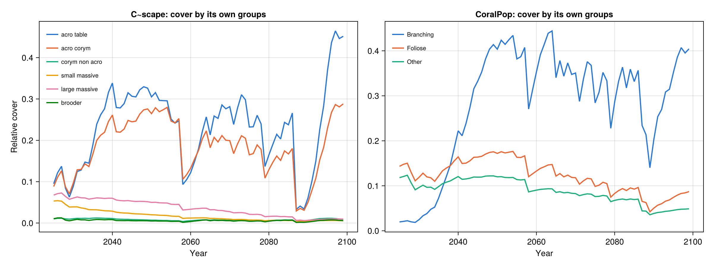

# Using ADRIAIndicators on C~scape and CoralPop output files

A self-contained, runnable walk-through: from the **saved output files of two coral models** to the standard
ADRIAIndicators metrics and indices, and on to a figure that compares the models. The two models are

- **C~scape**, the size-structured integral-projection model, whose results are R `.rds` files, and
- **CoralPop**, the Python coral population model, whose results are NumPy `.npz` files.

Each model was run once, with its default parameters, on the same synthetic one-reef domain (`SingleReef`, 2025–2099)
under a strong heat-stress series, so the metrics show how each model responds to repeated bleaching.

[ADRIAIndicators.jl](https://doi.org/10.5281/zenodo.17032475) is a Julia package of standard metrics for
summarising the state of a reef ecological model: cover, juveniles, shelter volume, diversity, and the Reef
Condition, Tourism, Fish and Biodiversity indices. It knows nothing about any particular model. It takes arrays
of coral cover, plus a few biological constants, and returns the metrics. Using it on a new model is therefore a
matter of **reading that model's own output files and putting the numbers into the layout the package expects**.
This guide shows how that is done for two models whose outputs look nothing alike, and that everything after
that step is identical.

This guide starts from the saved results. It does not run either model.


*`output/domain_metrics.png`, produced by `run_all.jl`. Top left: the heat stress (degree heating weeks, DHW) both
models were given. Other panels: one line per model (one run each); the markers, every 10 years, are those of the legend.*

**Everything needed is in this folder**: the model output files, the code, and the Julia environment. ADRIAIndicators
is the version in this repository. No model code is required.

---

## 1. What is in this folder

```
README.md                             this guide
Project.toml                          Julia environment (ADRIAIndicators from this repository)
run_all.jl                            the analysis: read files -> indicators -> checks -> CSV -> figures
src/adapters.jl                       the model-specific part: one function per model that reads its files
src/pipeline.jl                       the model-independent part: layout check, indicators, domain mean
data/
├── cscape/                           Array_scenario_101000100001_rep_1_draw_NA.rds   C~scape output: one run, one file (1 MB)
│   └── size_classes.rds              diameter and juvenile flag of C~scape's 100 size classes, per coral type
├── coralpop/                         scenario_1.npz                                  CoralPop output: one run, one file (49 KB)
│   └── scenarios.csv                 the parameter values of that run (all defaults; not used by the code)
└── domain/
    ├── singlereef_domain.csv         the reef's total and habitable area
    └── dhw_member17.csv              the heat-stress series (DHW per year) both models were forced with
output/                               what run_all.jl writes (already included): 2 figures + domain_metrics.csv
```

## 2. Run it

Requirements: **Julia 1.11 or newer** (tested with 1.11.5 and 1.12.5, which give the same results) and an internet connection the first time, to install
the packages. ADRIAIndicators is taken from this repository, the others (RData, NPZ, CairoMakie) from Julia's General
registry.

```bash
cd examples/coral_models
julia --project=. -e 'using Pkg; Pkg.instantiate()'   # first time only; precompiling CairoMakie takes several minutes
julia --project=. run_all.jl                          # 1-3 minutes, mostly loading CairoMakie and drawing; writes output/
```

`run_all.jl` prints the checks of STEP 4 (section 5) and a table of final-year values, and writes the two figures and
`output/domain_metrics.csv`. The script finds `data/` and `src/` relative to its own location.

## 3. The idea: one input layout, one reader per model

ADRIAIndicators works on arrays with dimensions **[timesteps ⋅ groups ⋅ sizes ⋅ locations]**, one run at a time.
A model is ready to use it once you can supply the following (*T* timesteps, *G* functional groups, *S* size
classes, *L* locations, *N* runs; here *N* = 1). This is the **standard layout** of this guide.

| Field | Shape | Meaning |
|---|---|---|
| `cover` | `[T, G, S, L, N]` | Cover of each functional group and size class as a **fraction of the location's habitable (k) area** |
| `k_area` | `[L]` | Habitable area of each location (m²) |
| `reef_area` | `[L]` | Total area of each location (m²); only used for LTMP cover |
| `diam_cm` | `[G, S, N]` | Mean colony diameter of each group / size class (cm) |
| `pap` | `[G, S, 2]` | Planar-area parameters (intercept *b*, coefficient *a*) of log(shelter volume) = *b* + *a*·log(*x*) (Aston et al. 2022) |
| `is_juvenile` | `[G, S]` | Which group / size classes count as juvenile |

Two constants complete the inputs and are the same for every model: the **reference colony** for relative shelter
volume (a 95 cm tabular *Acropora*, one per m²) and the **maximum juvenile density** (15 colonies per m²).

Neither model writes its results in this layout, and neither writes the same thing:

| | C~scape | CoralPop |
|---|---|---|
| Language, file | R, `saveRDS()` → `.rds`, one file per run | Python, `numpy.savez()` → `.npz`, one file per run |
| What is stored | one 6-D array of **colony counts** (and cover in %), per heat-tolerance class | the **colony surface area** (m²) per size bin and morphology, plus cover in % |
| Functional groups *G* | 6 coral types: tabular *Acropora*, corymbose *Acropora*, corymbose non-*Acropora*, small massives, large massives, brooders | 3 morphologies: Branching, Foliose, Other |
| Size classes *S* | 100 classes per type, from 0.5 cm up to 29 – 107 cm depending on the type, spaced evenly in log colony area | 20 bins of 5 cm width |
| Conversion to `cover` | colony count × colony area ÷ habitable area; add up heat classes | surface area ÷ habitable area |
| Colony diameter | read from the demography file (`size_classes.rds`) | from the bin edges |
| Juvenile classes | classes whose fecundity is zero (largest juvenile 2.7 – 12.4 cm, depending on type) | bins 1–2 (colonies under 10 cm) |
| First time step | 2024 = initial state; 2025 is the state after the first simulated year | 2025 = initial state |

That conversion is the **only** model-specific work. It lives in two functions, `read_cscape` and `read_coralpop`
(`src/adapters.jl`). Section 4 describes the files they read, and section 5 goes through the code step by step.

## 4. The model output files

### 4.1 The reef and its heat stress (`data/domain/`)

Both models were run on the same reef, so that differences between them come from the models, not from their inputs.
Neither model's output file records the reef's area, and ADRIAIndicators needs it (cover is a fraction of the
**habitable** area, which is smaller than the reef's total area), so it is read from a small description:

| `singlereef_domain.csv` | |
|---|---|
| `location_id` | `reef_01`: one synthetic reef, not observational data |
| `reef_area_m2` | 83 897 m², total area |
| `k_area_m2` | 38 910 m², habitable area (k = 46.4 % of the reef area) |

`dhw_member17.csv` is the heat stress that both models were forced with: ADRIA's RCP 4.5 climate member 17,
2025–2099, in degree heating weeks (°C-weeks). It is only used for the top-left panel of the figure.
4 °C-weeks is the usual bleaching threshold; it is exceeded in 58 of the 75 years, and 8 °C-weeks in 29 of them, with the
strongest event in 2087 (17.6 °C-weeks). There was no cyclone mortality.

### 4.2 C~scape: `data/cscape/Array_scenario_<id>_rep_<rep>_draw_<draw>.rds`

C~scape saves **one array per run (scenario)**. The file name carries the scenario id, the replicate of the disturbance
file (`rep`, here 1) and the posterior draw of the fitted demography that the run used (`draw`; `NA` means the median over
all posterior draws, which is the default).
R reads a file with `readRDS()`; in Julia, `RData.load` returns the same array:

```julia
using RData
a = RData.load("data/cscape/Array_scenario_101000100001_rep_1_draw_NA.rds")
size(a)        # (76, 1, 2, 6, 14, 107)
```

The array has six dimensions. R keeps their names, which the Julia reader does not return, so the order below
matters:

| # | Name | Length here | Meaning |
|---|---|---|---|
| 1 | `year` | 76 | `2024, 2025, …, 2099`. **Slot 1 is the initial state**, labelled one year before the first simulated year |
| 2 | `reef_siteid` | 1 | the sites (reef sections) of the domain: here the single site `reef_01` |
| 3 | `intervened` | 2 | `"no"` / `"yes"`: the part of each site without and with a coral deployment. Without an intervention everything is in `"no"` and `"yes"` is zero |
| 4 | `ft` | 6 | the functional (coral) types: `acro_table`, `acro_corym`, `corym_non_acro`, `small_massive`, `large_massive`, `brooder` |
| 5 | `enhancement` | 14 | heat-tolerance classes (−5 … 8 °C-weeks of added tolerance). Each colony belongs to one class, so a type's population is the sum over the 14 classes |
| 6 | `value` | 107 | what is stored; see below |

The R output of `str(dimnames(a))`:

```
List of 6
 $ year       : chr [1:76] "2024" "2025" "2026" "2027" ...
 $ reef_siteid: chr "reef_01"
 $ intervened : chr [1:2] "no" "yes"
 $ ft         : chr [1:6] "acro_table" "acro_corym" "corym_non_acro" "small_massive" ...
 $ enhancement: chr [1:14] "-5" "-4" "-3" "-2" ...
 $ value      : chr [1:107] "cover" "1" "2" "3" ...
```

The last dimension holds, in this order (C~scape's `layout.R`):

| `value` slot | Content | Unit |
|---|---|---|
| 1 | `cover`: the cover of this type and heat class | **percent of the site's area** (not of the habitable area) |
| 2 – 6 | five early life stages: external eggs, settlers received, internal eggs, internal larvae, settlers after the juvenile cap | counts |
| **7 – 106** | **the 100 size classes** | **number of colonies** |
| 107 | `lambda` (population growth rate), not filled in | – |

Only the size classes (slots 7 – 106) are needed. They are **counts of colonies**, not cover, so converting them to
cover needs the diameter of each size class. Every size class is a point of C~scape's size mesh. The 100
diameters and the flag of which classes are juvenile are part of the demography of each coral type, not of the output
file, so `data/cscape/size_classes.rds` holds them: for each type, `meshpoints_diam` (cm) and `juvenile` (classes whose
fecundity is zero in every posterior draw). Together with the counts that is all that is needed.

### 4.3 CoralPop: `data/coralpop/scenario_<n>.npz`

CoralPop's engine returns a set of NumPy arrays for each run, and each file stores them unchanged. The site
dimension is always last. With one site it has length 1.

```
surface_area_m2   float64  (75, 20, 3, 1)   [time, size bin, morphology, site]   colony surface area, m²
cover_pct         float64  (75, 3, 1)       [time, morphology, site]             cover, % of the reef area
benthic_pct       float64  (75, 10, 1)      [time, benthic category, site]       % of the reef area
larvae_produced   float64  (75, 2, 1)       [time, spawner group, site]          eggs
larvae_received   float64  (75, 2, 1)       [time, spawner group, site]          larvae from other sites
benthic_columns   <U25     (10,)            names of the benthic categories
```

- **Time**: the 75 rows are the years 2025–2099. Row 1 is the **initial state** of 2025; every further row is the state
  after one more simulated year.
- **Morphologies**: `Branching`, `Foliose`, `Other`, in that order.
- **Size bins**: 20 bins of 5 cm: bin *b* covers [5(*b*−1), 5*b*) cm. The engine represents a bin by
  √(lo²/2 + hi²/2), e.g. 3.5 cm for the first bin and 97.5 cm for the last.
- **`surface_area_m2`** is the planar area of all colonies in a bin, in m² of the *whole reef*. It is neither per
  m² nor a fraction. Dividing by the habitable area gives the cover that ADRIAIndicators needs.
- **`cover_pct`** is a percentage of the *reef* area (not the habitable area). It is used only as a check.

### 4.4 Where the files come from

Each model was run **once, with its default parameters** on the `SingleReef` domain: no parameter sampling, so there is
no spread to show, only one trajectory per model. For C~scape that means the median demography (`draw = NA`), plasticity 0
and neutral mortality, growth and recruitment scales; for CoralPop every growth, mortality, bleaching and recruitment
scale is 1 and the random seed is 1 (`data/coralpop/scenarios.csv`). Both models start from the same initial cover.

The CoralPop files are what the CoralPop engine returned (`numpy.savez` of its result, nothing added). The C~scape files
are C~scape's `out_array` in the R package's own file format. They were generated with CScape.jl, the Julia
implementation of C~scape, which has the same array layout, and written to `.rds` with R's `saveRDS`, using the same dimension names and file naming as the R package. The R package
`cscape` (v1.0.0) itself reproduces the stored cover from the stored counts, so a C~scape `.rds` array written by the R
package is read by `read_cscape` unchanged, as long as it has the same six types and 14 heat classes. The scripts that
made the files use AIMS-internal model code and are not part of this repository.

## 5. The pipeline, step by step

```
data/cscape/*.rds    --STEP 2: read_cscape  --┐
data/coralpop/*.npz  --STEP 2: read_coralpop--┴-> standard layout [T, G, S, L, N]
                                                  --STEP 3: ADRIAIndicators--> indicators [T, L, N]
                                                  --STEP 3: area-weighted mean--> domain metrics [T, N]
                                                  --STEP 4: compare with each model's own cover
                                                  --STEP 5: indicators --> CSV
                                                  --STEP 6: CairoMakie--> figures
```

The code below is the content of `run_all.jl` (the steps), `src/adapters.jl` (reading the files) and `src/pipeline.jl`
(the indicators), unchanged.

### Setup

`run_all.jl` loads the two source files and the plotting library, and says where the data are.

```julia
include(joinpath(@__DIR__, "src", "adapters.jl"))
include(joinpath(@__DIR__, "src", "pipeline.jl"))
import CairoMakie as Mk
using Printf

const DATA_DIR = joinpath(@__DIR__, "data")
const OUT_DIR = mkpath(joinpath(@__DIR__, "output"))
```

`src/adapters.jl` uses `RData` (to read `.rds`), `NPZ` (to read `.npz`) and `DelimitedFiles` (for the small CSVs).
`src/pipeline.jl` starts with `import ADRIAIndicators as AI`: every ADRIAIndicators function is called as `AI.something`.

```julia
using RData, NPZ, DelimitedFiles
```

```julia
import ADRIAIndicators as AI
using Statistics
```

### STEP 1: the reef, its heat stress, and the constants both models share

**What is happening.** Neither output file knows the area of the reef, so the reef's total and habitable area are read
first (`read_reef`). Both are needed in m²: the habitable area to turn each model's quantity into a *fraction* of the
habitable area, the total area for LTMP cover. The heat-stress series is read too, for the first panel of the figure.

```julia
# ===== STEP 1: the reef and its heat stress =====

reef = read_reef(joinpath(DATA_DIR, "domain", "singlereef_domain.csv"))
dhw_table, dhw_header = readdlm(joinpath(DATA_DIR, "domain", "dhw_member17.csv"), ','; header=true)
YEARS = collect(2025:2099)
dhw = Float64.(dhw_table[:, findfirst(==("dhw"), vec(dhw_header))])      # one reef: one DHW value per year
@assert Int.(dhw_table[:, 1]) == YEARS
```

```julia
# ===== The reef both models were run on =====

"""
    read_reef(path) -> NamedTuple

The one-reef domain the models ran on: location id, total reef area (m2) and habitable ("k") area (m2). Neither
model's output file contains these, and ADRIAIndicators needs both, so they are read from the domain description.
"""
function read_reef(path::AbstractString)
    data, header = readdlm(path, ','; header=true)
    col(name) = data[:, findfirst(==(name), vec(header))]
    return (; ids=String.(col("location_id")), reef_area=Float64.(col("reef_area_m2")), k_area=Float64.(col("k_area_m2")))
end
```

Two constants are fixed for both models so that their shelter volumes and juvenile indicators are on the same scale.
They are conventions of ADRIA, not outputs of either model:

```julia
# ===== constants both models share =====

## Reference colony that relative shelter volume is scaled against: one tabular Acropora of 95 cm
## diameter per m2, given as (diameter in cm, intercept b, coefficient a) of log(S) = b + a log(x).
## This is ADRIA's convention; it is what makes shelter volume comparable between models.
const SV_REFERENCE = (95.0, -8.95, 2.80)

## Juvenile density (colonies per m2) at which the juvenile indicator reaches 1 (ADRIA's value).
const MAX_JUVENILE_DENSITY = 15.0
```

### STEP 2: read each model's output files into the standard layout

Both readers return the same named tuple (`label`, `years`, `groups`, `locations`, `cover`, `k_area`, `reef_area`,
`diam_cm`, `pap`, `is_juvenile`; see section 3).

```julia
# ===== STEP 2: read each model's own output files =====

cscape = read_cscape(joinpath(DATA_DIR, "cscape"), reef; years=YEARS)
coralpop = read_coralpop(joinpath(DATA_DIR, "coralpop"), reef; years=YEARS)
```

**Planar-area parameters.** Shelter volume is derived from the *planar area* of a colony, which depends on the
coral morphology. ADRIAIndicators takes the parameters (*b*, *a*) of log(planar area) = *b* + *a*·log(diameter) for
each group and size class. Both models use ADRIA's table for its five functional groups; the only decision is
which row each model's group takes.

```julia
# ===== Planar-area parameters (shelter volume) =====

## log(S) = b + a log(x), (b, a) per ADRIA functional group -- Aston et al. (2022), as ADRIA.planar_area_params().
## Rows: tabular Acropora, corymbose Acropora, corymbose non-Acropora, small massives, large massives.
const PLANAR_AREA = [
    -8.95 2.80
    -9.13 2.94
    -8.90 2.94
    -8.87 2.30
    -8.87 2.30
]

"[groups, sizes, 2] planar-area parameters when group `g` uses ADRIA row `rows[g]`, the same for every size class."
planar_area_for(rows, n_sizes) = repeat(reshape(PLANAR_AREA[rows, :], length(rows), 1, 2), 1, n_sizes, 1)
```

**C~scape: counts → cover.** `read_cscape` does the following for every run's file (here there is one):

1. `RData.load` reads the 6-D array. The shape is checked against the layout of section 4.2.
2. It **drops year slot 1** (2024, the initial state), so that the 75 remaining time steps are 2025 – 2099, and keeps
   only the 100 size-class slots (7 – 106). These are colony counts.
3. It adds the counts over the two `intervened` sub-areas (the second is empty here, but this keeps the reader correct for
   runs with a coral deployment) and over the 14 heat-tolerance classes. Counts can be added, cover would first need
   weighting.
4. It converts counts to cover. A colony of diameter *d* cm has a planar area of π(*d*/200)² m², so
   *cover = count × colony area ÷ habitable area*, as a fraction clamped to [0, 1].
5. The colony diameters and juvenile flags come from `size_classes.rds`. The planar-area row of the brooders is
   the one of corymbose non-*Acropora*, as brooding corals here are *Pocillopora*-like.

```julia
# ===== C~scape =====

const CSCAPE_TYPES = ["acro_table", "acro_corym", "corym_non_acro", "small_massive", "large_massive", "brooder"]
const CSCAPE_SIZE_SLOTS = 7:106        # value slots 7..106 of out_array hold the 100 size classes (colony COUNTS)

"""
    read_cscape(dir, reef; years) -> NamedTuple

Read every `Array_scenario_*.rds` in `dir` (one file per run, sorted by scenario id).
"""
function read_cscape(dir::AbstractString, reef; years=2025:2099)
    files = filter(f -> occursin(r"^Array_scenario_.*\.rds$", f), readdir(dir))
    sort!(files; by=f -> parse(Int, match(r"scenario_(\d+)", f).captures[1]))
    sc = RData.load(joinpath(dir, "size_classes.rds"))
    d_cm = permutedims(reduce(hcat, [Float64.(sc[ft]["meshpoints_diam"]) for ft in CSCAPE_TYPES]))   # [6, 100]
    juvenile = permutedims(reduce(hcat, [Bool.(sc[ft]["juvenile"]) for ft in CSCAPE_TYPES]))         # [6, 100]
    G, S = size(d_cm)
    L, N = length(reef.ids), length(files)

    colony_area_m2 = π .* (d_cm ./ 200) .^ 2                       # diameter in cm -> radius in m -> area in m2
    cover = zeros(length(years), G, S, L, N)
    for (n, f) in enumerate(files)
        out = RData.load(joinpath(dir, f))                         # [year, site, intervened, type, heat class, value]
        size(out) == (length(years) + 1, L, 2, G, 14, 107) || error("$f has unexpected shape $(size(out))")
        ## counts: skip slot 1 (2024), keep the 100 size classes, add the two `intervened` sub-areas and the 14 heat classes
        counts = dropdims(sum(out[2:end, :, :, :, :, CSCAPE_SIZE_SLOTS]; dims=(3, 5)); dims=(3, 5))   # [T, L, G, S]
        counts = permutedims(counts, (1, 3, 4, 2))                                                    # [T, G, S, L]
        cover[:, :, :, :, n] = clamp.(counts .* reshape(colony_area_m2, 1, G, S, 1) ./ reshape(reef.k_area, 1, 1, 1, L), 0, 1)
    end
    return (; label="C~scape", years=collect(years), groups=CSCAPE_TYPES, locations=reef.ids, cover,
        k_area=reef.k_area, reef_area=reef.reef_area, diam_cm=repeat(d_cm, 1, 1, N),
        pap=planar_area_for([1, 2, 3, 4, 5, 3], S), is_juvenile=juvenile)          # brooders use the corymbose non-Acropora row
end
```

**CoralPop: area → cover.** `read_coralpop` has less to do, because CoralPop already stores an area. It reads
`surface_area_m2` from each file and divides by the habitable area; it asks `NPZ.jl` for that one array because
the package cannot read the file's text array (`benthic_columns`). It moves the dimensions into the order
`[time, morphology, size bin, site]`. The bin diameters are computed from the bin edges, and the first two bins (colonies
under 10 cm) are the juveniles. For shelter volume, the morphologies take the planar-area row of: Branching → corymbose
*Acropora*, Foliose → tabular *Acropora*, Other → large massives. This is the mapping used in CoralPop's ADRIA
interface and is a modelling choice, not a fact stored in the files.

```julia
# ===== CoralPop =====

const CORALPOP_MORPHS = ["Branching", "Foliose", "Other"]
const CORALPOP_BIN_CM = 5.0            # 20 size bins of 5 cm

"Mean colony diameter (cm) of CoralPop's size bin `b` (1-based), as the engine computes it: sqrt(lo^2/2 + hi^2/2)."
coralpop_bin_diameter(b; bin=CORALPOP_BIN_CM) = sqrt(((b - 1) * bin)^2 / 2 + (b * bin)^2 / 2)

"""
    read_coralpop(dir, reef) -> NamedTuple

Read every `scenario_*.npz` in `dir`. The 75 rows of the engine's time axis are the years 2025-2099.
"""
function read_coralpop(dir::AbstractString, reef; years=2025:2099)
    files = filter(f -> occursin(r"^scenario_\d+\.npz$", f), readdir(dir))
    sort!(files; by=f -> parse(Int, match(r"scenario_(\d+)", f).captures[1]))
    B, M = 20, length(CORALPOP_MORPHS)
    L, N = length(reef.ids), length(files)

    cover = zeros(length(years), M, B, L, N)
    for (n, f) in enumerate(files)
        ## NPZ.jl cannot read the file's text array (benthic_columns), so ask for the array we need
        area = npzread(joinpath(dir, f), ["surface_area_m2"])["surface_area_m2"]    # [T, bin, morph, site], m2
        size(area) == (length(years), B, M, L) || error("$f has unexpected shape $(size(area))")
        cover[:, :, :, :, n] = clamp.(permutedims(area, (1, 3, 2, 4)) ./ reshape(reef.k_area, 1, 1, 1, L), 0, 1)
    end
    d_cm = repeat(reshape([coralpop_bin_diameter(b) for b in 1:B], 1, B), M, 1)       # [morph, bin]
    juvenile = falses(M, B)
    juvenile[:, 1:2] .= true                                                          # bins 1-2: colonies < 10 cm
    return (; label="CoralPop", years=collect(years), groups=CORALPOP_MORPHS, locations=reef.ids, cover,
        k_area=reef.k_area, reef_area=reef.reef_area, diam_cm=repeat(d_cm, 1, 1, N),
        pap=planar_area_for([2, 1, 5], B), is_juvenile=juvenile)                      # Branching, Foliose, Other -> ADRIA rows 2, 1, 5
end
```

**Check.** After this step, both models are in the same layout, with 75 years × 1 site × 1 run: `[75, 6, 100, 1, 1]`
for C~scape and `[75, 3, 20, 1, 1]` for CoralPop.

### STEP 3: check the layout, then compute the indicators

**What is happening.** `check_model` stops with a readable message if a shape is wrong, cover is outside [0, 1], or the
habitable area exceeds the reef area. Then `compute_indicators` calls ADRIAIndicators for every run
(ADRIAIndicators works on one run at a time, `[T, G, S, L]`) and returns every indicator as `[T, L, N]`;
`domain_metrics` collapses the location dimension to give `[T, N]`.

```julia
# ===== STEP 3: check the standard layout, then compute the indicators =====

models = (cscape, coralpop)
results = map(models) do m
    check_model(m)
    ind = compute_indicators(m)                       # [timesteps, locations, runs]
    dom = domain_metrics(m, ind)                      # [timesteps, runs]
    @info "$(m.label): $(size(m.cover, 5)) run, $(size(m.cover, 4)) location(s), " *
          "$(length(m.years)) years ($(first(m.years))-$(last(m.years)))"
    (; m, ind, dom)
end
```

```julia
# ===== check that a model is in the standard layout =====

"""
    check_model(m)

The standard layout, one NamedTuple per model (T timesteps, G functional groups, S size classes,
L locations, N runs; N = 1 in this example):

| field         | shape           | meaning                                                                |
|---------------|-----------------|------------------------------------------------------------------------|
| `cover`       | `[T, G, S, L, N]` | cover of each group / size class as a FRACTION of the location's habitable (k) area |
| `k_area`      | `[L]`           | habitable area of each location (m2)                                   |
| `reef_area`   | `[L]`           | total area of each location (m2)                                       |
| `diam_cm`     | `[G, S, N]`     | mean colony diameter of each group / size class (cm)                   |
| `pap`         | `[G, S, 2]`     | planar-area parameters (intercept, coefficient)                        |
| `is_juvenile` | `[G, S]`        | which group / size classes count as juvenile                           |

plus `label`, `years`, `groups` and `locations`. Stops with a readable message if a shape or range is wrong.
"""
function check_model(m)
    T, G, S, L, N = size(m.cover)
    length(m.years) == T || error("$(m.label): $(length(m.years)) years but cover has $T timesteps")
    length(m.groups) == G || error("$(m.label): $(length(m.groups)) group names but cover has $G groups")
    size(m.diam_cm) == (G, S, N) || error("$(m.label): diam_cm is $(size(m.diam_cm)), expected $((G, S, N))")
    size(m.pap) == (G, S, 2) || error("$(m.label): pap is $(size(m.pap)), expected $((G, S, 2))")
    size(m.is_juvenile) == (G, S) || error("$(m.label): is_juvenile is $(size(m.is_juvenile)), expected $((G, S))")
    length(m.k_area) == L && length(m.reef_area) == L || error("$(m.label): k_area / reef_area must have $L entries")
    all(0 .<= m.cover .<= 1) || error("$(m.label): cover must be a fraction of habitable area in [0, 1]")
    all(m.k_area .<= m.reef_area) || error("$(m.label): habitable area exceeds reef area")
    return nothing
end
```

ADRIAIndicators is organised in layers, which is how `compute_indicators` is built:

1. **Cover** (`relative_cover`, `relative_loc_taxa_cover`, `ltmp_cover`) collapses the group and size dimensions.
2. **Shelter volume and juveniles** need the biology: diameters, planar-area parameters, the juvenile flags.
3. **Diversity** (`coral_evenness`, `coral_diversity`) works on the per-group cover `[T, G, L]`.
4. **Indices** (Reef Condition, Tourism, Fish and Biodiversity Condition) are combinations of the metrics above and need
   no further model input.

```julia
# ===== the indicators, per location and run =====

## (key, title shown on the figure)
const METRICS = [
    (:relative_cover, "Relative cover"),
    (:relative_juveniles, "Relative juveniles"),
    (:juvenile_indicator, "Juvenile indicator"),
    (:relative_shelter_volume, "Relative shelter volume"),
    (:absolute_shelter_volume, "Absolute shelter volume (m³)"),
    (:coral_evenness, "Coral evenness"),
    (:coral_diversity, "Coral diversity"),
    (:reef_condition_index, "Reef Condition Index"),
    (:reef_tourism_index, "Reef Tourism Index"),
    (:reef_fish_index, "Reef Fish Index"),
    (:reef_biodiversity_condition_index, "Reef Biodiversity Condition Index"),
]

"""
    compute_indicators(m) -> Dict{Symbol,Array{Float64,3}}

Every indicator of `METRICS` as a `[timesteps, locations, runs]` array, using only ADRIAIndicators.
ADRIAIndicators works on one run at a time (`[T, G, S, L]`), so this loops over the runs.
"""
function compute_indicators(m)
    T, G, S, L, N = size(m.cover)
    out = Dict{Symbol,Array{Float64,3}}(k => zeros(T, L, N) for (k, _) in METRICS)

    for n in 1:N
        cover = m.cover[:, :, :, :, n]                                  # [T, G, S, L]
        diam_cm = m.diam_cm[:, :, n]                                    # [G, S]

        ## -- cover --
        rc = AI.relative_cover(cover)                                   # [T, L]  all groups and sizes
        taxa = AI.relative_loc_taxa_cover(cover)                        # [T, G, L]  per group
        ltmp = AI.ltmp_cover(cover, m.k_area, m.reef_area)              # [T, L]  relative to REEF area

        ## -- shelter volume: ADRIAIndicators returns it per group / size class; add them up and,
        ##    for the relative version, clamp to [0, 1] (the metric's definition) --
        rsv = AI.relative_shelter_volume(cover, diam_cm, m.pap, m.k_area, SV_REFERENCE)
        rsv = clamp.(dropdims(sum(rsv; dims=(2, 3)); dims=(2, 3)), 0.0, 1.0)             # [T, L]
        asv = AI.absolute_shelter_volume(cover, diam_cm, m.pap, m.k_area)
        asv = dropdims(sum(asv; dims=(2, 3)); dims=(2, 3))                               # [T, L], m3

        ## -- juveniles. NOTE the unit: the indicator needs diameters in METRES, shelter volume in CM --
        rjuv = AI.relative_juveniles(cover, m.is_juvenile)              # [T, L]
        jind = AI.juvenile_indicator(cover, m.is_juvenile, m.k_area, diam_cm ./ 100.0, MAX_JUVENILE_DENSITY)

        ## -- diversity --
        even = AI.coral_evenness(taxa)                                  # [T, L]
        div = AI.coral_diversity(taxa)                                  # [T, L]

        ## -- indices built from the metrics above (no rubble: neither model has it) --
        rci = AI.reef_condition_index(ltmp, rsv, jind)
        rti = AI.reef_tourism_index_no_rubble(ltmp, even, rsv, rjuv)
        rfi = AI.reef_fish_index(rc)
        rbci = AI.reef_biodiversity_condition_index(rc, div, rsv)

        for (k, v) in (:relative_cover => rc, :relative_juveniles => rjuv, :juvenile_indicator => jind,
            :relative_shelter_volume => rsv, :absolute_shelter_volume => asv, :coral_evenness => even,
            :coral_diversity => div, :reef_condition_index => rci, :reef_tourism_index => rti,
            :reef_fish_index => rfi, :reef_biodiversity_condition_index => rbci)
            out[k][:, :, n] .= v
        end
    end
    return out
end
```

Domain metrics: every location counts in proportion to its habitable area (`AI.scenario_metric`), except for the
one absolute quantity, the shelter volume in m³, which is added up. This example has a single reef, so the domain
value equals that reef's value; with many reefs each counts in proportion to its habitable area.

```julia
# ===== from locations to the domain =====

"""
    domain_metrics(m, ind) -> Dict{Symbol,Matrix{Float64}}

Collapse the location dimension of every indicator: the k-area weighted mean (each location counts in
proportion to its habitable area) -- or, for the one absolute quantity (shelter volume in m3), the sum.
Result: `[timesteps, runs]`. With a single location both are the location's own value.
"""
function domain_metrics(m, ind)
    return Dict(k => k === :absolute_shelter_volume ?
                     AI.scenario_metric(v, m.k_area, 2; is_relative=false, return_relative=false) :
                     AI.scenario_metric(v, m.k_area, 2)
                for (k, v) in ind)
end
```

### STEP 4: check the readers against each model's own cover

**What is happening.** A reader that mis-handles a unit does not fail. It silently gives wrong numbers. Each
model also stores its **own** cover, in different units, and this step recomputes it from the file with the unit
conversion of that model and compares it with what the reader produced:

- C~scape stores the cover in value slot 1 as a percent of the *site* area, which is converted to a fraction of the habitable area.
- CoralPop's `cover_pct` is a percent of the *reef* area, which is converted in the same way.

```julia
# ===== Each model's own cover number, for checking the adapters =====

"""
    native_cover_cscape(dir, reef; years) -> Array{Float64,3}

C~scape's own total cover (value slot 1 of `out_array`), as relative cover `[T, L, N]`. It is stored in PERCENT of
the site area, per type and heat class, so it is summed and converted to a fraction of the habitable area.
"""
function native_cover_cscape(dir::AbstractString, reef; years=2025:2099)
    files = filter(f -> occursin(r"^Array_scenario_.*\.rds$", f), readdir(dir))
    sort!(files; by=f -> parse(Int, match(r"scenario_(\d+)", f).captures[1]))
    out = zeros(length(years), length(reef.ids), length(files))
    for (n, f) in enumerate(files)
        a = RData.load(joinpath(dir, f))
        pct = dropdims(sum(a[2:end, :, :, :, :, 1]; dims=(3, 4, 5)); dims=(3, 4, 5))       # [T, L], % of site area
        out[:, :, n] = pct ./ 100 .* reshape(reef.reef_area, 1, :) ./ reshape(reef.k_area, 1, :)
    end
    return out
end

"""
    native_cover_coralpop(dir, reef; years) -> Array{Float64,3}

CoralPop's own `cover_pct` (percent of REEF area per morphology), as relative cover `[T, L, N]`.
"""
function native_cover_coralpop(dir::AbstractString, reef; years=2025:2099)
    files = filter(f -> occursin(r"^scenario_\d+\.npz$", f), readdir(dir))
    sort!(files; by=f -> parse(Int, match(r"scenario_(\d+)", f).captures[1]))
    out = zeros(length(years), length(reef.ids), length(files))
    for (n, f) in enumerate(files)
        pct = npzread(joinpath(dir, f), ["cover_pct"])["cover_pct"]                          # [T, morph, L]
        out[:, :, n] = dropdims(sum(pct; dims=2); dims=2) ./ 100 .* reshape(reef.reef_area, 1, :) ./ reshape(reef.k_area, 1, :)
    end
    return out
end
```

```julia
# ===== STEP 4: check the adapters against each model's own cover =====

native = (native_cover_cscape(joinpath(DATA_DIR, "cscape"), reef; years=YEARS),
    native_cover_coralpop(joinpath(DATA_DIR, "coralpop"), reef; years=YEARS))
println("\nRelative cover recomputed from the colony data vs the model's own cover (max |difference|):")
for (r, nat) in zip(results, native)
    mine = r.ind[:relative_cover]
    ## CoralPop's first row is the cover it was GIVEN as input, the others come from its size classes: check apart
    @printf("  %-9s all years %.2e   years 2026-2099 %.2e\n", r.m.label, maximum(abs.(mine .- nat)),
        maximum(abs.(mine[2:end, :, :] .- nat[2:end, :, :])))
end
```

Output (`run_all.jl`):

```
Relative cover recomputed from the colony data vs the model's own cover (max |difference|):
  C~scape   all years 7.77e-16   years 2026-2099 7.77e-16
  CoralPop  all years 1.19e-06   years 2026-2099 3.33e-16
```

The two agree to rounding. The one exception is the first year of CoralPop: its first row of `cover_pct` is the cover the
engine was *given* as an input, while its `surface_area_m2` is rebuilt from the initial size distribution, which
differs by 1×10⁻⁶. Every year after that agrees to 3×10⁻¹⁶.

### STEP 5: write the indicators to a CSV

**What is happening.** Every indicator of every model, one value per year, is written to `output/domain_metrics.csv`
(`model, metric, year, value`), and the final-year values are printed. With several runs per model you would summarise them here
(median and interquartile range over the last dimension).

```julia
# ===== STEP 5: write the indicators to a CSV =====

open(joinpath(OUT_DIR, "domain_metrics.csv"), "w") do io
    println(io, "model,metric,year,value")
    for r in results, (key, _) in METRICS
        v = vec(r.dom[key])                           # one run: [timesteps, 1] -> [timesteps]
        for (t, yr) in enumerate(r.m.years)
            @printf(io, "%s,%s,%d,%.6g
", r.m.label, key, yr, v[t])
        end
    end
end

println("
Indicators in $(last(YEARS)):")
@printf("  %-36s %12s %12s
", "", cscape.label, coralpop.label)
for (key, title) in METRICS
    v = [only(r.dom[key][end, :]) for r in results]
    @printf("  %-36s %12.4g %12.4g
", title, v[1], v[2])
end
```

### STEP 6: the figures

**What is happening.** Each model keeps one colour, line style and marker throughout (as in the six-model comparison
figure), so the two can be told apart without relying on colour alone. A panel shows one line per model, with a marker every 10
years. The first figure is the 12 panels at the top of this guide: the heat
stress and the 11 metrics. The second figure shows cover by each model's *own* functional groups, which helps to read
diversity and evenness (pitfall 7 in section 8).

```julia
# ===== STEP 6: figures =====

## Okabe-Ito colours, line style and marker per model (as in the six-engine comparison figure).
const STYLE = Dict(
    "C~scape" => (color=Mk.Makie.to_color("#D55E00"), linestyle=:dash, marker=:rect),
    "CoralPop" => (color=Mk.Makie.to_color("#009E73"), linestyle=:dot, marker=:utriangle),
)

"One model's line on `ax`; a marker every 10 years so that the legend's marker can be found on the line."
function model_line!(ax, years, y, label)
    st = STYLE[label]
    Mk.lines!(ax, years, vec(y); color=st.color, linewidth=2, linestyle=st.linestyle, label=label)
    Mk.scatter!(ax, years[1:10:end], vec(y)[1:10:end]; color=st.color, marker=st.marker, markersize=8)
end

"A legend with colour + line style + marker per model."
function model_legend!(pos, labels; kw...)
    elems = [[Mk.LineElement(color=STYLE[l].color, linestyle=STYLE[l].linestyle, linewidth=2),
        Mk.MarkerElement(color=STYLE[l].color, marker=STYLE[l].marker, markersize=9)] for l in labels]
    Mk.Legend(pos, elems, labels; framevisible=false, kw...)
end

function domain_metrics_figure(results, years, dhw)
    ncols = 3
    nrows = cld(length(METRICS) + 1, ncols)
    fig = Mk.Figure(; size=(1400, 380 * nrows))
    ax = Mk.Axis(fig[1, 1]; title="Heat stress forcing (DHW)", titlesize=15, ylabel="DHW (°C-weeks)")
    Mk.barplot!(ax, years, dhw; color=:grey60, gap=0.1)
    Mk.hlines!(ax, [4, 8]; color=:grey30, linestyle=:dash, linewidth=1)
    for (i, (key, title)) in enumerate(METRICS)
        row, col = fld1(i + 1, ncols), mod1(i + 1, ncols)
        ax = Mk.Axis(fig[row, col]; title, titlesize=15, xlabel=row == nrows ? "Year" : "")
        for r in results
            model_line!(ax, r.m.years, r.dom[key], r.m.label)
        end
    end
    model_legend!(fig[nrows + 1, :], [r.m.label for r in results]; orientation=:horizontal)
    Mk.Label(fig[0, :], "Domain-mean ADRIAIndicators metrics (one run per model; SingleReef, DHW member 17)"; fontsize=18)
    return fig
end

fig = domain_metrics_figure(results, YEARS, dhw)
Mk.save(joinpath(OUT_DIR, "domain_metrics.png"), fig; px_per_unit=2)

## Cover of each model's OWN functional groups: why diversity and evenness differ between the models
const GROUP_COLORS = Mk.Makie.to_color.(["#2a78d6", "#eb6834", "#1baf7a", "#eda100", "#e87ba4", "#008300"])

function native_groups_figure(results, years)
    fig = Mk.Figure(; size=(1200, 450))
    for (j, r) in enumerate(results)
        ax = Mk.Axis(fig[1, j]; title="$(r.m.label): cover by its own groups", xlabel="Year",
            ylabel=j == 1 ? "Relative cover" : "")
        for g in eachindex(r.m.groups)
            ## cover of group g: sum over size classes, as a fraction of habitable area; one location, one run
            y = vec(sum(r.m.cover[:, g, :, 1, 1]; dims=2))
            Mk.lines!(ax, years, y; color=GROUP_COLORS[mod1(g, length(GROUP_COLORS))], linewidth=2,
                label=replace(r.m.groups[g], "_" => " "))
        end
        Mk.axislegend(ax; position=:lt, labelsize=10, framevisible=false)
    end
    return fig
end

Mk.save(joinpath(OUT_DIR, "cover_by_native_group.png"), native_groups_figure(results, YEARS); px_per_unit=2)
@info "Wrote domain_metrics.png, cover_by_native_group.png and domain_metrics.csv to $OUT_DIR"
```

## 6. Results

Values in 2099 (printed by `run_all.jl`):

| Metric | C~scape | CoralPop |
|---|---:|---:|
| Relative cover | 0.770 | 0.540 |
| Relative juveniles | 0.0177 | 0.0054 |
| Juvenile indicator | 0.097 | 0.073 |
| Relative shelter volume | 0.207 | 0.103 |
| Absolute shelter volume (m³) | 255 | 127 |
| Coral evenness | 0.344 | 0.561 |
| Coral diversity | 0.515 | 0.406 |
| Reef Condition Index | 0.1 | 0.1 |
| Reef Tourism Index | 0.66 | 0.70 |
| Reef Fish Index | 17.8 | 14.6 |
| Reef Biodiversity Condition Index | 0.497 | 0.350 |



*`output/cover_by_native_group.png`: cover of each model's own functional groups.*

What the figures show:

- **Both models follow the heat stress.** Cover rises from about 0.3 to 0.65–0.75 of the habitable area by 2050–2054, then drops after
  the strong events of 2058 (13 °C-weeks) and 2087–2089 (up to 17.6). C~scape falls from 0.57 (2057) to 0.25 (2058) and to 0.08
  (2087); CoralPop falls from 0.69 to 0.48 and to 0.34 (0.22 in 2089). C~scape loses more in each event.
- **They recover differently.** C~scape's cover returns to 0.77 by 2099, carried by tabular and corymbose *Acropora*
  (second figure). CoralPop's recovers to 0.54, mostly as branching colonies (0.40 of the habitable area), with foliose and other
  morphologies much smaller.
- **Indicators that depend on size and group differ most.** Shelter volume is higher in C~scape for most of
  the run (several times higher around 2050), while the juvenile indicator is higher in CoralPop until about 2060. Evenness is lower
  in C~scape because two of its six groups carry nearly all cover; the definitions behind these indicators are in section 8.
- **The Reef Condition Index is categorical.** It takes one of five values (0.1 – 0.9), so it jumps between categories.

Because the metrics are the same functions applied to the same layout, those differences come from the models and
their inputs, not from how the metrics were calculated. The caveats of section 8 apply to how far they can be
interpreted. This is one default run per model: it shows each model's trajectory, not its uncertainty.

## 7. ADRIAIndicators functions used

All are called as `AI.<name>` (`import ADRIAIndicators as AI`).

| Figure panel | Function | Takes | Returns / notes |
|---|---|---|---|
| Relative cover | `relative_cover(cover)` | `[T,G,S,L]` | `[T,L]`, fraction of habitable area |
| (LTMP cover) | `ltmp_cover(cover, k_area, reef_area)` | | `[T,L]`, fraction of **reef** area; input to RCI and RTI |
| (per-group cover) | `relative_loc_taxa_cover(cover)` | | `[T,G,L]`; input to diversity and evenness |
| Relative juveniles | `relative_juveniles(cover, is_juvenile)` | mask `[G,S]` | `[T,L]` |
| Juvenile indicator | `juvenile_indicator(cover, is_juvenile, k_area, diam_m, max_density)` | **diameters in metres** | `[T,L]`, 1 = maximum theoretical juvenile density |
| Relative shelter volume | `relative_shelter_volume(cover, diam_cm, pap, k_area, reference)` | **diameters in cm** | `[T,G,S,L]`; sum over G and S, then clamp to [0,1] |
| Absolute shelter volume | `absolute_shelter_volume(cover, diam_cm, pap, k_area)` | | `[T,G,S,L]` in m³; sum over G and S |
| Coral evenness | `coral_evenness(taxa_cover)` | `[T,G,L]` | inverse Simpson index ÷ G (Hill 1973); 0 when there is no coral |
| Coral diversity | `coral_diversity(taxa_cover)` | `[T,G,L]` | Gini–Simpson index, 1 − Σp² |
| Reef Condition Index | `reef_condition_index(ltmp, rsv, juvenile_indicator)` | `[T,L]` each | categorical: 0.1, 0.3, 0.5, 0.7, 0.9. A 4-argument form adds rubble |
| Reef Tourism Index | `reef_tourism_index_no_rubble(ltmp, evenness, rsv, rel_juveniles)` | | regression, rounded and clamped to [0.1, 0.9]. `reef_tourism_index` is the variant **with rubble** |
| Reef Fish Index | `reef_fish_index(rel_cover)` | | regression on relative cover (Graham & Nash 2013) |
| Reef Biodiversity Condition Index | `reef_biodiversity_condition_index(rel_cover, diversity, rsv)` | | mean of the three, clamped to [0, 1] |
| (domain mean) | `scenario_metric(metric, area, dim; is_relative, return_relative)` | | area-weighted mean (or sum) over a dimension |

The package has more than this example uses: taxa-level cover and juveniles, LTMP taxa cover, `absolute_coral_area`,
`coral_area_saved` (intervention against counterfactual) and the relative ↔ LTMP cover conversions. Every function has a
docstring (`?AI.relative_cover`).

## 8. Pitfalls when applying ADRIAIndicators to a model's own output

1. **Know what the stored quantity is.** C~scape stores colony *counts* (and a cover in *percent of the site area*),
   CoralPop stores *m² of colony surface* (and cover in *percent of the reef area*). ADRIAIndicators wants a *fraction
   of the habitable area*. Convert, and check the result against the model's own total cover (STEP 4).
2. **Habitable area, not reef area.** `ltmp_cover` converts to the reef area using `k_area ./ reef_area`; `k_area ≤ reef_area` is checked.
3. **Units.** Shelter volume takes colony diameters in **centimetres**; the juvenile indicator takes them in **metres**.
   Passing centimetres to the juvenile indicator makes it 10⁴ times too small, and the Reef Condition Index can then never
   reach its juvenile criterion.
4. **Shelter volume is returned per group and size class.** Sum over groups and sizes yourself; for the relative
   version clamp to [0, 1] afterwards (a single large class can exceed the 95 cm reference colony).
5. **The time axis.** C~scape stores its *initial state* as the first slot (2024). CoralPop's first row (2025) is also the
   initial state, but C~scape's 2025 is already the state after the first year of simulation. This guide drops C~scape's
   slot 1 so both cover 2025–2099. The two models therefore differ by one simulated year at the start (relative cover of
   0.33 against 0.28 in 2025); make a deliberate choice for your own comparison.
6. **Juvenile definitions are model-specific.** C~scape's juveniles are the size classes without fecundity (largest juvenile
   diameter 2.7–12.4 cm depending on type), CoralPop's the two smallest bins (under 10 cm). The *largest juvenile diameter*
   sets the juvenile indicator's denominator, so juvenile indicators are comparable between models only as far as these
   definitions are.
7. **Different groups give different evenness and diversity.** Evenness is normalised by the number of groups (C~scape 6,
   CoralPop 3, which are growth forms rather than ADRIA's functional groups). Compare shapes, or map both models onto a common
   set of groups first. The mapping of CoralPop's morphologies to planar-area rows (for shelter volume) is a modelling choice too.
8. **Sum what can be summed.** Heat-tolerance classes and the `intervened` sub-areas of C~scape hold counts that are added
   up. Do not add up cover per class in a different unit.
9. **Reading the files.** `RData.load` returns the C~scape array without its dimension names; use the order of section 4.2.
   `NPZ.jl` cannot read the text array in CoralPop's files; ask for the arrays you need (`npzread(file, ["surface_area_m2"])`).
10. **CoralPop's largest size bin.** The engine's diameter for its last bin depends on the state of the run and is not stored
    in the output. The fixed value of the bin edges (97.5 cm) is used. The bin is empty for most of this run.
11. **One element type.** The ADRIAIndicators functions are generic in one floating-point type: do not mix `Float32` and
    `Float64` arguments (it raises a `MethodError`).
12. **One run at a time.** Most functions take `[T,G,S,L]`; loop over runs (scenarios) if you have several, as `compute_indicators` does.
13. **Rubble.** Neither model has rubble, so the no-rubble variants are used. If yours does, use
    `reef_condition_index(ltmp, rsv, juv, rubble)` and `reef_tourism_index`.

## 9. Using your own model

Write one function that returns the named tuple of section 3 from your model's files, and call `check_model`,
`compute_indicators` and `domain_metrics` on it. Decide what counts as a juvenile, the colony diameter of each size
class, which planar-area parameters apply to each group, and which quantity your model stores (counts, area, cover; of the
reef or of the habitable area).

```julia
m = (; label="MyModel", years=2025:2099, groups=["a", "b"], locations=["reef_1"],
       cover, k_area, reef_area, diam_cm, pap, is_juvenile)   # your arrays, shapes as in section 3
check_model(m)                                                 # stops with a clear message if a shape or range is wrong
ind = compute_indicators(m)                                    # Dict: metric => [T, L, N]
dom = domain_metrics(m, ind)                                   # Dict: metric => [T, N]
```

## 10. Versions, provenance and licence

- Tested with Julia 1.11.5 and 1.12.5; CairoMakie 0.15.15, RData 1.1.0, NPZ 0.4.3.
- ADRIAIndicators.jl is the version of this repository (MIT licence). Please cite it as in `CITATION.cff` (DOI 10.5281/zenodo.17032475).
- `data/` was produced on 2026-10-13 from one default run of each model (CoralPop engine: Python 3.12, numpy 2.5,
  CoralPop-Engine 032824c).
- References behind the metrics: Aston et al. (2022) *Front. Mar. Sci.* 9, doi:10.3389/fmars.2022.854395
  (planar-area parameters); Urbina-Barreto et al. (2021) *Ecol. Indic.* 121, 107151 (shelter volume);
  Hill (1973) *Ecology* 54, 427–432 (evenness); Graham & Nash (2013) *Coral Reefs* 32, 315–326 (fish index);
  Heneghan et al. (2025) preprint, doi:10.21203/rs.3.rs-7644150/v1 (condition and tourism indices).
